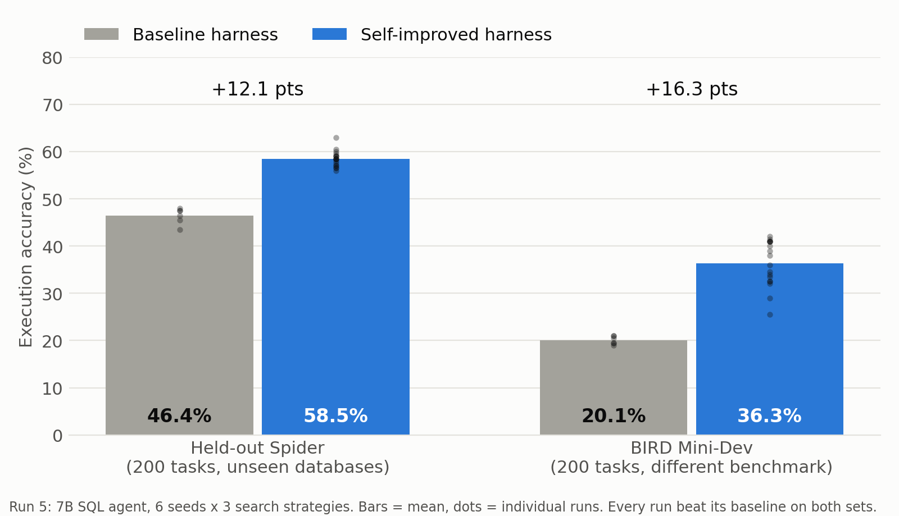
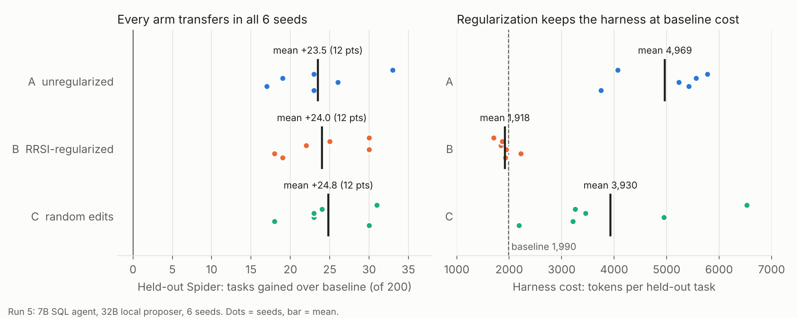

# Chiron

**Self-improving language-model agents, without fine-tuning.**

Chiron makes a small model better at runtime. It watches the model work, finds where it fails, and rewrites what the model sees (its prompt memory and its agent harness) so the same weights score higher on problems it has never seen.

[Results](#results) · [Architecture](docs/architecture.svg) · [Harness-evolution pilot](rsi_pilot/README.md) · [Write-up](docs/writeup/post.md)



## Results

### Self-improving SQL agent: +12 points on unseen databases, +16 points on BIRD

A 7B SQL agent (`qwen2.5:7b-instruct`) evolves its own harness on 50 Spider tasks, guided by a local 32B proposer. The evolved harness is then frozen and scored on data it never saw.

| Evaluation set | Baseline harness | Self-improved harness | Gain |
|---|---:|---:|---:|
| Held-out Spider (200 tasks, unseen databases) | 46.4% | **58.5%** | **+12.1 pts** |
| BIRD Mini-Dev (200 tasks, different benchmark) | 20.1% | **36.3%** | **+16.3 pts (1.8x)** |

- **18 of 18 runs improved** on both sets (6 seeds x 3 search strategies).
- **Pre-registered**: predictions and analysis plan were committed before the run.
- **No extra cost**: the regularized (RRSI-style) arm matched the gain while keeping the harness at baseline size, 1,918 tokens per task against the baseline's 1,990.
- The loop found real, general fixes on its own, most often showing the full database schema up front, adding sample rows to table descriptions, and verifying a query before submitting it.



Full design, leakage controls, per-seed tables and statistics: [`rsi_pilot/README.md`](rsi_pilot/README.md).

### Runtime teacher repair: coding accuracy +67% relative

Student `meta-llama/Llama-3.2-3B-Instruct`, teacher `minimax/minimax-m2.5` on [Prime](https://docs.primeintellect.ai/inference/overview). Drift fired on the hard bucket, the teacher repaired the failures, verified repairs became few-shot memory, and the same student recovered:

| Hard coding problems | Accuracy |
|---|---:|
| Before correction | 0.273 |
| After correction | **0.455** |
| Gain | **+0.182** |

Reproduce with `bash scripts/use_prime_student.sh full`.

### Runtime teacher repair: text-to-SQL

| Setup | Before | After | Gain |
|---|---:|---:|---:|
| Local 1.5B student + MiniMax teacher | 0.100 | **0.333** | +0.233 (3.3x) |
| MiniMax student + teacher | 0.300 | **0.567** | +0.267 |

### Research infrastructure

- **Experiment design**: frozen splits, tuning / fresh / held-out / cross-benchmark sets, 6-seed paired statistics (exact Wilcoxon, Holm correction), leakage checks, test-suite re-scoring.
- **Cloud runs on Lambda A10 GPUs**: API client with budget ledger, auto-terminate watchdog, one-command bootstrap; runs 4 and 5 (36 arm-runs) cost about $49 in total. See [`rsi_pilot/CLOUD_RUN.md`](rsi_pilot/CLOUD_RUN.md).
- **Write-up and figures**: [`docs/writeup/post.md`](docs/writeup/post.md), [`docs/PROJECT_NOTES.md`](docs/PROJECT_NOTES.md) (architecture diagrams and the full project record).

---

## How the loop works

```
Harness ──telemetry──▶ Detector ──drift──▶ Correction (teacher)
   ▲                                              │
   └──────── few-shots (+ optional KG rules) ─────┘
                    events.jsonl ──▶ Viewer
```

| Piece | Job |
|-------|-----|
| [`harness/`](harness/) | Runs the student, scores outputs |
| [`detector/`](detector/) | Windowed accuracy; fires when it drops |
| [`correction/`](correction/) | Teacher repair → verified few-shots; optional KG |
| [`viewer/`](viewer/) | Plots the run from `events.jsonl` |

The student **weights never change**. Only its prompt memory changes.

**Memory lookup:** few-shots are filtered by domain (`db_id` / topic). KG rules match by **substring** (trigger phrase or table/column name in the question), not embeddings.

---

## Setup

Python ≥ 3.10.

```bash
git clone https://github.com/RohanChavan0701/Chiron.git
cd Chiron
pip install -e .
pip install -r requirements.txt   # if you want the viewer / extras
```

Hermetic tests (no API key):

```bash
python fixtures/generate_mocks.py
pytest -q
```

Put keys in `.env` (gitignored), e.g.:

```bash
PRIME_API_KEY=...          # coding on Prime
# or
OPENROUTER_API_KEY=...
```

---

## Run something real

### Coding on Prime (recommended entrypoint)

```bash
bash scripts/use_prime_student.sh list
bash scripts/use_prime_student.sh smoke    # student + teacher unit-test check
bash scripts/use_prime_student.sh probe    # cheap WITH/WITHOUT
bash scripts/use_prime_student.sh full     # full loop + recovery
```

Hard-curriculum style eval (learn on hard, score held-out hard):

```bash
bash scripts/use_prime_student.sh curriculum
```

Overrides: `PRIME_AGENT_MODEL=...`, `PRIME_TEACHER_MODEL=...`.

### Coding on OpenRouter

```bash
bash scripts/use_openrouter_student.sh smoke
bash scripts/use_openrouter_student.sh curriculum
```

### Orchestrator (any adapter)

```bash
python orchestrator.py --adapter coding --full --fresh
python orchestrator.py --adapter spider --probe
python orchestrator.py --adapter gsm8k --full --fresh
```

### Viewer (offline)

```bash
make demo
# or: VIEWER_LOG=events.jsonl uvicorn viewer.app:app --port 8011
```

---

## Layout

```
contracts/     Shared schemas + events.jsonl I/O
adapters/      coding, spider_sql, gsm8k_math, finance
harness/       Student client, feeds, eval / sandbox
detector/      Drift detection
correction/    Teacher, few-shots, KG (graph / inject)
viewer/        Live UI over the event log
analysis/      Paired bootstrap CIs
fixtures/      Problem subsets + mocks
scripts/       Prime / OpenRouter entrypoints, held-out freezing, multi-seed eval
rsi_pilot/     Self-improving harness experiments (own venv, README, run logs, cloud tooling)
orchestrator.py
```

---

## More domains

- **GSM8K**: uplift-gated memory that admits only examples shown to help ([`docs/FINDINGS_REASONING.md`](docs/FINDINGS_REASONING.md)).
- **Finance / PRBench**: rubric-graded reasoning with per-task teacher plans (feature branches `feat/finance-*`, `feat/q1-self-plan`).
- **Coding**: curriculum runs and multi-seed evaluation ([`docs/FINDINGS_CODING.md`](docs/FINDINGS_CODING.md)).

## Origin

The four-stage loop and orchestrator were built in a hackathon window starting 2026-07-01. The adapters, findings docs, and `rsi_pilot/` are follow-on work on the same codebase; the git log is the record of what landed when.

---

## Author

[Rohan Chavan](https://github.com/rohanpc0701)
