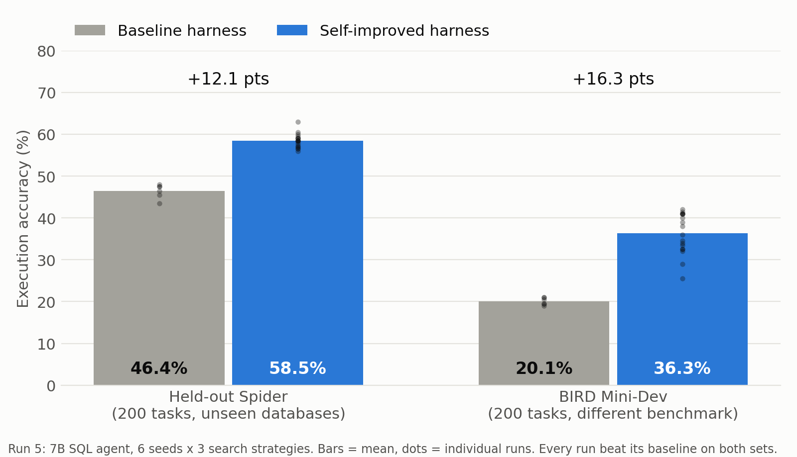
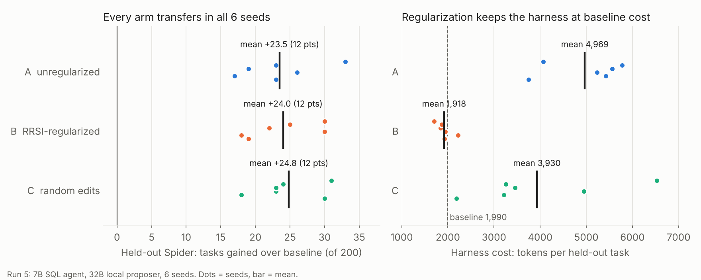

# Chiron

**Self-improving language-model agents, without fine-tuning.**

Chiron makes a small model better at runtime. It watches the model work, finds where it fails, and rewrites what the model sees (its prompt memory and its agent harness) so the same weights score higher on problems it has never seen.

[Results](#results) · [Architecture](docs/architecture.svg) · [Harness-evolution pilot](rsi_pilot/README.md) · [Write-up](docs/writeup/post.md)



## Results

### Self-improving SQL agent: +12 points on unseen databases, +16 points on BIRD

A 7B SQL agent (`qwen2.5:7b-instruct`) evolves its own harness on 50 Spider-train tasks. The evolved harness is then frozen and scored on 200 held-out Spider dev tasks (unseen databases) and 200 BIRD Mini-Dev tasks. Three search arms, 6 seeds each; mean (SD) over seeds:

| Harness | What it is | Held-out Spider % | Test-suite-corrected % | BIRD % |
|---|---|---:|---:|---:|
| baseline | unevolved harness, re-scored each seed | 46.42 (1.69) | 35.00 (1.61) | 20.08 (0.86) |
| A | 32B LLM proposer, keeps any edit that helps | 58.17 (1.51) | 44.33 (5.44) | 36.67 (3.74) |
| B | same proposer, regularized (RRSI-style) | 58.42 (1.36) | 47.25 (1.81) | 35.75 (6.02) |
| C | random edits with A's keep rule (control) | 58.83 (2.29) | 46.75 (4.26) | 36.58 (5.50) |

**Controlled comparison.** Paired per seed on held-out Spider, A minus C is -0.67 pp (SD 1.86, exact Wilcoxon p = 0.53, pre-registered secondary endpoint) and B minus C is -0.42 pp (SD 2.91). We measured no accuracy advantage for the 32B proposer over the random-edit control on held-out Spider. The pre-registered primary endpoint, B minus A, is +0.25 pp (p = 0.84).

**What held.**
- Every evolved arm beat the baseline in 6 of 6 seeds, on held-out Spider and on BIRD (18 of 18 runs). The raw held-out gain is about +12 pp (A +11.8, B +12.0, C +12.4); under the test-suite re-score it is +9.3 pp for A, +12.3 for B and +11.8 for C. On BIRD it is about +16 pp. With 6 seeds, p = 0.031 is the smallest exact p possible (Holm-corrected 0.25 in the pre-registered family).
- Exploratory, not pre-registered: the regularized arm got its gain at baseline token cost, 1,918 tokens per held-out task against 1,990 for the baseline and 4,969 for A.

**Grader audit.**
- 19% to 25% of held-out passes fail Spider's distilled test-suite databases (baseline 24.6%, A 23.8%, B 19.1%, C 20.5%). Absolute accuracies are inflated by 11 to 14 points; the gain over baseline survives.
- Scoring uses Spider's official result comparison. Tasks whose gold query returns no rows were excluded when the splits were built, and the audit counts 0 such passes in every seed.
- BIRD has no test suite. The per-seed BIRD hand-label files (`audit_bird_labels.csv`, 20 passes each) are not labeled yet, so the BIRD numbers are unaudited.

**Scope.**
- Seeds replicate the search, not the test set: the same 200 held-out tasks are used in every seed.
- The baseline harness showed only table names, so much of the gain is supplying missing general information (most often the full schema up front or sample rows in table descriptions).
- The baseline's own SD across reruns of the same harness on the same tasks is 1.69 pp.
- Spider 1.0 is likely in the student's pretraining data. That affects every arm equally, but it limits what the absolute numbers mean.



Numbers: [`arm_stats.md`](rsi_pilot/runs_v5/arm_stats.md) (reproduce with `python scripts/arm_stats.py` from `rsi_pilot/`), [`summary.csv`](rsi_pilot/runs_v5/summary.csv), [`seed_level.md`](rsi_pilot/runs_v5/seed_level.md). Predictions: [`PREDICTION_run5.md`](rsi_pilot/PREDICTION_run5.md). Design, leakage controls and caveats: [`rsi_pilot/README.md`](rsi_pilot/README.md).

### Runtime teacher repair: coding accuracy +67% relative

Student `meta-llama/Llama-3.2-3B-Instruct`, teacher `minimax/minimax-m2.5` on [Prime](https://docs.primeintellect.ai/inference/overview). Drift fired on the hard bucket, the teacher repaired the failures, verified repairs became few-shot memory, and the same student recovered:

| Hard coding problems | Accuracy |
|---|---:|
| Before correction | 0.273 |
| After correction | **0.455** |
| Gain | **+0.182** |

Reproduce with `bash scripts/use_prime_student.sh full`.

### Runtime teacher repair: text-to-SQL

| Setup | Before | After | Gain |
|---|---:|---:|---:|
| Local 1.5B student + MiniMax teacher | 0.100 | **0.333** | +0.233 (3.3x) |
| MiniMax student + teacher | 0.300 | **0.567** | +0.267 |

### Research infrastructure

- **Experiment design**: frozen splits, tuning / fresh / held-out / cross-benchmark sets, 6-seed paired statistics (exact Wilcoxon, Holm correction), leakage checks, test-suite re-scoring.
- **Cloud runs on Lambda A10 GPUs**: API client with budget ledger, auto-terminate watchdog, one-command bootstrap; runs 4 and 5 (36 arm-runs) cost about $49 in total. See [`rsi_pilot/CLOUD_RUN.md`](rsi_pilot/CLOUD_RUN.md).
- **Write-up and figures**: [`docs/writeup/post.md`](docs/writeup/post.md), [`docs/PROJECT_NOTES.md`](docs/PROJECT_NOTES.md) (architecture diagrams and the full project record).

---

## How the loop works

```
Harness ──telemetry──▶ Detector ──drift──▶ Correction (teacher)
   ▲                                              │
   └──────── few-shots (+ optional KG rules) ─────┘
                    events.jsonl ──▶ Viewer
```

| Piece | Job |
|-------|-----|
| [`harness/`](harness/) | Runs the student, scores outputs |
| [`detector/`](detector/) | Windowed accuracy; fires when it drops |
| [`correction/`](correction/) | Teacher repair → verified few-shots; optional KG |
| [`viewer/`](viewer/) | Plots the run from `events.jsonl` |

The student **weights never change**. Only its prompt memory changes.

**Memory lookup:** few-shots are filtered by domain (`db_id` / topic). KG rules match by **substring** (trigger phrase or table/column name in the question), not embeddings.

---

## Setup

Python ≥ 3.10.

```bash
git clone https://github.com/RohanChavan0701/Chiron.git
cd Chiron
pip install -e .
pip install -r requirements.txt   # if you want the viewer / extras
```

Hermetic tests (no API key):

```bash
python fixtures/generate_mocks.py
pytest -q
```

Put keys in `.env` (gitignored), e.g.:

```bash
PRIME_API_KEY=...          # coding on Prime
# or
OPENROUTER_API_KEY=...
```

---

## Run something real

### Coding on Prime (recommended entrypoint)

```bash
bash scripts/use_prime_student.sh list
bash scripts/use_prime_student.sh smoke    # student + teacher unit-test check
bash scripts/use_prime_student.sh probe    # cheap WITH/WITHOUT
bash scripts/use_prime_student.sh full     # full loop + recovery
```

Hard-curriculum style eval (learn on hard, score held-out hard):

```bash
bash scripts/use_prime_student.sh curriculum
```

Overrides: `PRIME_AGENT_MODEL=...`, `PRIME_TEACHER_MODEL=...`.

### Coding on OpenRouter

```bash
bash scripts/use_openrouter_student.sh smoke
bash scripts/use_openrouter_student.sh curriculum
```

### Orchestrator (any adapter)

```bash
python orchestrator.py --adapter coding --full --fresh
python orchestrator.py --adapter spider --probe
python orchestrator.py --adapter gsm8k --full --fresh
```

### Viewer (offline)

```bash
make demo
# or: VIEWER_LOG=events.jsonl uvicorn viewer.app:app --port 8011
```

---

## Layout

```
contracts/     Shared schemas + events.jsonl I/O
adapters/      coding, spider_sql, gsm8k_math, finance
harness/       Student client, feeds, eval / sandbox
detector/      Drift detection
correction/    Teacher, few-shots, KG (graph / inject)
viewer/        Live UI over the event log
analysis/      Paired bootstrap CIs
fixtures/      Problem subsets + mocks
scripts/       Prime / OpenRouter entrypoints, held-out freezing, multi-seed eval
rsi_pilot/     Self-improving harness experiments (own venv, README, run logs, cloud tooling)
orchestrator.py
```

---

## More domains

- **GSM8K**: uplift-gated memory that admits only examples shown to help ([`docs/FINDINGS_REASONING.md`](docs/FINDINGS_REASONING.md)).
- **Finance / PRBench**: rubric-graded reasoning with per-task teacher plans (feature branches `feat/finance-*`, `feat/q1-self-plan`).
- **Coding**: curriculum runs and multi-seed evaluation ([`docs/FINDINGS_CODING.md`](docs/FINDINGS_CODING.md)).

## Origin

The four-stage loop and orchestrator were built in a hackathon window starting 2026-07-01. The adapters, findings docs, and `rsi_pilot/` are follow-on work on the same codebase; the git log is the record of what landed when.

---

## Author

[Rohan Chavan](https://github.com/rohanpc0701)
