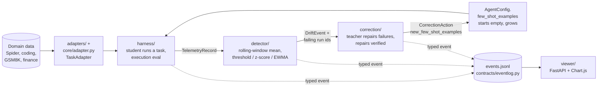
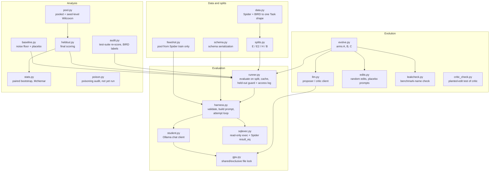
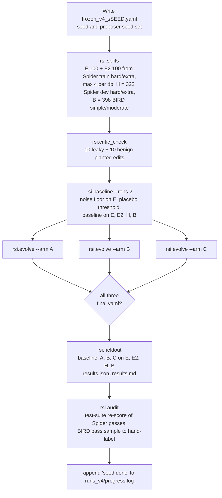
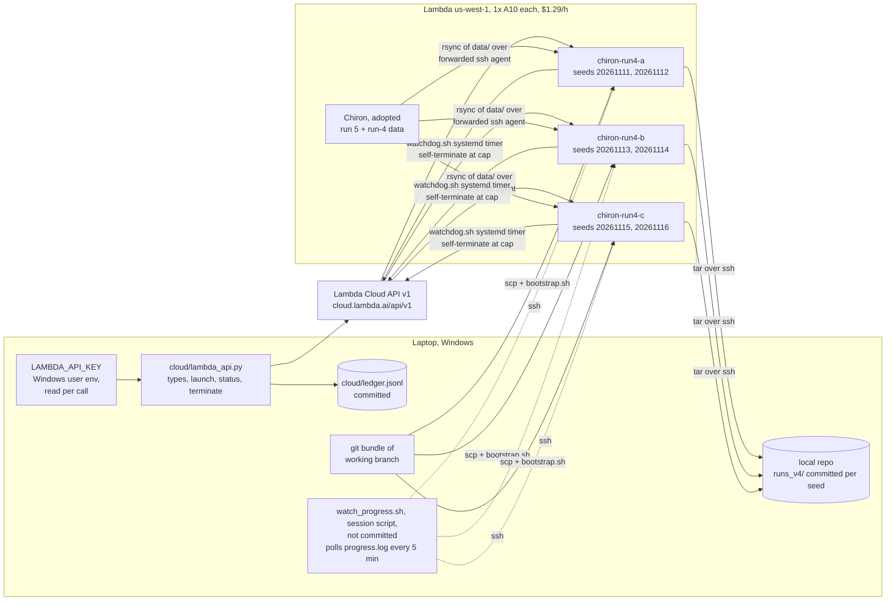

# Chiron: project notes (state as of 2026-11-03 13:00 UTC)

One file that records what the project is, how every part is built, what was run, what it
found, what it cost, what went wrong, and what is still open. Numbers here are copied from
committed outputs; the source file is named next to each table. Where something was not
checked, this file says so.

Contents

1. What Chiron is
2. System architecture (the runtime self-correction loop)
3. The harness-evolution pilot (`rsi_pilot/`)
4. Run 4 pipeline, per seed
5. Cloud infrastructure for run 4
6. Results: runs 1 to 3
7. Results: run 4 (pre-registered)
8. Run 4 exploratory analyses (not pre-registered)
9. Run 4 deviations and incidents
10. Cost and timeline
11. Tests and verification
12. Known inconsistencies in the repo
13. Open items
14. How to describe this work (resume and interviews)

---

## 1. What Chiron is

Two lines of work on one codebase (`github.com/RohanChavan0701/Chiron`).

| Line | Question | Where | Status |
|---|---|---|---|
| Runtime self-correction | When a small student model's accuracy drifts, can a stronger teacher's verified repairs, added as few-shot memory, make the same student recover without weight updates? | `harness/`, `detector/`, `correction/`, `viewer/`, `adapters/`, `orchestrator.py` | Same-distribution recovery works as a demo; hard held-out transfer mostly does not (`docs/FINDINGS_CODING.md`) |
| Harness-evolution pilot | Does an LLM-driven loop that edits the student's harness config (RRSI-style) produce gains that transfer to held-out data, and does regularization help? | `rsi_pilot/` (standalone, own venv) | Five runs done. Run 4 (single-shot, 1.5B student, pre-registered, 6 seeds): no transfer, primary endpoint null. Run 5 (multi-step agent, 7B student, pre-registered, 6 seeds, merged to main in PR #2): transferred about +12 points on held-out Spider, but random edits matched the LLM proposer and regularization did not change accuracy |

Provenance: started as a hackathon build (first commit 2026-07-01); everything after the
four-stage loop is follow-on research (`.claude/rules/03-provenance.md`).

---

## 2. System architecture (the runtime self-correction loop)

Contracts (`contracts/schemas.py`, frozen): `AgentConfig`, `TelemetryRecord`, `DriftEvent`,
`CorrectionAction`. Canonical field names are domain-agnostic (`generated_output`,
`correct_output`, `domain_id`, `invalid_output`); legacy SQL names are accepted on input as
aliases. Every record carries `difficulty` so accuracy can be stratified.

Locked design decisions (`.claude/rules/02-tech-decisions.md`):

- Detector is statistical, no training; drift is judged over a window of about 20 to 30 runs,
  never one query.
- The stream has a change-point: easy/medium questions, then a shift to hard/extra-hard.
- Correction learns from failures (teacher repairs become few-shot examples, anchored against
  forgetting); it never "fixes" drift by swapping models.
- Models go through one OpenAI-compatible client (`harness/agent.py`, `correction/provider.py`).

Main-loop results (from the top-level `README.md`):

| Setting | Without memory | After correction | Change | Caveat |
|---|---:|---:|---:|---|
| Coding, Llama-3.2-3B student, MiniMax-M2.5 teacher, hard bucket | 0.273 | 0.455 | +0.182 | Same distribution |
| Spider, local 1.5B student, MiniMax teacher | 0.100 | 0.333 | +0.233 | 30 queries, no held-out split, Spider likely in pretraining |
| Spider, MiniMax student and teacher (original build) | 0.300 | 0.567 | +0.267 | Same as above |

Held-out coding transfer mostly does not hold (`docs/FINDINGS_CODING.md`).

---

## 3. The harness-evolution pilot (`rsi_pilot/`)

Inspired by RRSI (Regularized Recursive Self-Improvement of Agent Harnesses, arXiv
2609.24972). No RRSI code is used; Arm B reimplements three of its ideas.

### 3.1 What gets evolved: the harness

The harness is a small config file (`rsi_pilot/harness.yaml`), validated in
`rsi/harness.py` (`EDITABLE_FIELDS`). Nine editable fields:

| Field | Baseline value | Allowed values |
|---|---|---|
| `system_prompt` | "You are an expert SQLite developer..." | free text |
| `schema_format` | `create_table` | `create_table`, `compact` |
| `sample_rows` | 0 | 0 to 5 rows per table |
| `include_foreign_keys` | true | bool |
| `fewshot_k` | 0 | 0 to 8 examples from Spider train |
| `fewshot_rule` | `lexical` | `fixed`, `lexical` |
| `max_retries` | 0 | 0 to 3 extra attempts after an execution error |
| `feed_execution_errors` | true | bool |
| `instructions_suffix` | "" | free text |

Not editable by the loop (fixed in `frozen*.yaml`): student model, temperature, seed,
context, whether BIRD's evidence hint is included, verifier.

### 3.2 Module map

### 3.3 Leakage controls

- E and H come from disjoint databases (run 4: E and E2 from Spider train, H from Spider dev;
  train and dev use disjoint databases).
- `runner.py` refuses to score any non-baseline harness on H, B or E2 until every arm has
  `final.yaml`, and appends every such evaluation to `heldout_access.jsonl`.
- The proposer sees only E failures; gold SQL is hidden (`show_gold_sql_to_proposer: false`).
- Few-shot examples come from Spider train only; the pool asserts no database overlap with
  E, H or B (run 1 found `formula_1` shared between Spider train and BIRD and removed it).
- Arm A's edits are leak-checked and logged (not enforced) so leakage can be counted.
- Checked for run 4: across all six seeds, non-baseline harnesses appear in
  `heldout_access.jsonl` only with purposes `heldout_final` and `audit`.

### 3.4 The arms (run 4)

| Arm | Proposer | Edit size | Keep rule | Extra screens |
|---|---|---|---|---|
| A, unregularized | qwen2.5:32b-instruct | any number of fields | beats current harness on E by 1 task | leak check logged only |
| B, RRSI-lite | qwen2.5:32b-instruct | cosine budget, 3 fields down to 1 | beats current by the placebo threshold (floor 2 tasks) | leak check and LLM critic enforced; pruning after the run reverts fields that do not help or cost 1.25x tokens without enough gain |
| C, random search | none | 1 to 3 random fields; text from fixed generic menus written before any run | same as A | none |

Arm C is the selection control: if it matches A, the LLM proposer adds nothing over blind
search plus best-of-3 selection on E.

Placebo threshold: ten meaning-preserving rewordings of the baseline system prompt are scored
on E; their spread sets Arm B's keep threshold (`rsi/edits.py`, `rsi/baseline.py`).

---

## 4. Run 4 pipeline, per seed

Script: `rsi_pilot/scripts/run_v4.sh SEED 4`. Each step is skipped if its output already
exists, which is how a crashed arm can be rerun alone.

Evolution: 10 generations x 3 candidates per arm, 8 failure traces shown per generation,
history of the last 12 candidates shown to the proposer.

Fixed settings (`frozen_v4.yaml`):

| Role | Model | Settings |
|---|---|---|
| Student | qwen2.5:1.5b-instruct (digest 65ec06548149) | temperature 0, seed 20261102, ctx 8192, max 512 tokens |
| Proposer | qwen2.5:32b-instruct (digest 9f13ba1299af) | temperature 0.7, seed = run seed, ctx 8192, max 1536 tokens |
| Critic | qwen2.5:32b-instruct | temperature 0, seed 20261102, ctx 8192 |
| Verifier | Spider official `result_eq` | BIRD evidence included, DISTINCT kept, 30 s exec timeout |

GPU lock (`rsi/gpu.py`): with the 32B model resident, Ollama put the 1.5B student partly on
the CPU, and that changed its greedy outputs (same harness scored 36 and 39 of 100). Fix: a
file lock (student calls shared, big-model calls exclusive), big-model calls unload everything
and use `keep_alive=0`, and every student call checks the student is fully in VRAM.

---

## 5. Cloud infrastructure for run 4

Guardrails (author's, `rsi_pilot/CLOUD_RUN.md`), enforced in `lambda_api.py` and tested in
`tests/test_cloud.py`:

- Only 1x A10, found by specs from the live type listing, never by a remembered name.
- Cap per launch = min(48 h, budget_usd x 100 / live price in cents). Run 4: budget $50 total
  split three ways, so $16.67 each, cap 12.92 h at $1.29/h.
- At most `MAX_OPEN = 4` open instances (the adopted one plus three).
- Name prefix `chiron-`; author approval text recorded in the launch line.
- Terminate only ids that this ledger launched; never by name or type; refuses double terminate.
- Watchdog (option 1): on each instance a systemd timer calls the terminate endpoint at
  `terminate_by`, using a header file `/root/.lambda_hdr` (mode 600) sent over ssh stdin, so
  the key never appears in a command line, log, commit or chat.
- The API key is never written to the repo.

Bootstrap (`cloud/bootstrap.sh`): clone the bundle, create the venv, install Ollama 0.40.13
(same as the original instance), pull both models, rsync `data/` from the adopted instance
through the laptop's forwarded ssh agent (no key added anywhere), check both model digests
(abort on mismatch), run the tests.

API facts verified 2026-11-02 against Lambda's OpenAPI spec 1.10.0: Bearer auth; launch takes
`region_name`, `instance_type_name`, exactly one `ssh_key_names`, optional `user_data`
(cloud-init); billing runs until terminate (an OS shutdown does not stop it); Cloudflare
blocks Python urllib's default User-Agent (error 1010), so the client sets one.

---

## 6. Results: runs 1 to 3

Source: `rsi_pilot/README.md`. n = 50 per set; 1.5B student; 14B proposer. No predictions were
registered for runs 1 to 3.

Run 1 (one seed, AgentWatch verifier):

| Harness | E | H | B |
|---|---|---|---|
| baseline | 48% | 20% | 10% |
| arm A | 62% | 26% | 8% |
| arm B | 58% | 28% | 12% |

No comparison reached p < 0.05. Test-suite re-scoring found about half of E passes were false
positives, many from gold queries returning no rows.

Run 2 (changes after critique of run 1: seeded native-API proposer, `llama3.1:8b` critic,
edit history, empty-gold tasks excluded, at most 6 tasks per database):

| Harness | E | H | B |
|---|---|---|---|
| baseline | 40% | 58% | 6% |
| arm A | 48% | 46% | 6% |
| arm B | 50% | 64% | 10% |

B vs A on H: +18%, 13/4, p = 0.049 uncorrected (one of nine tests).

Run 3 (three replicates of run 2, seeds 20261103 to 20261105). Pooled with run 2
(`runs_pooled_v2v3.md`, exact sign test on summed tasks):

| Comparison | E | H | B |
|---|---|---|---|
| A vs baseline | +20 (p 0.007) | -9 (p 0.20) | +1 (p 1.0) |
| B vs baseline | +19 (p 0.014) | -2 (p 0.86) | +1 (p 1.0) |
| B vs A | -1 (p 1.0) | +7 (p 0.25) | +0 (p 1.0) |

Run 2's B-over-A result did not replicate. Both arms reliably improve E; neither improves H or B.

---

## 7. Results: run 4 (pre-registered)

Pre-registration: `rsi_pilot/PREDICTION.md`, commit e085db7 (committed 02:25, pushed 02:26 UTC
on 2026-11-03). That was 8 minutes after the first attempt at seed 20261111 started, when only
its baseline numbers existed, and before any evolution or held-out result. Amendment 1 (commit 5d1cf41, 02:35 UTC, before any seed finished): 6 seeds
instead of 10. Per `PREDICTION.md`, the predictions were written by the AI coding assistant
that built run 4, at the author's request, and not edited by the author.

Pooled analysis, run once after all six seeds: `python -m rsi.pool runs_v4/s* --seed-level`,
output `rsi_pilot/runs_v4/pooled_seed_level.md`. Unit = seed; exact two-sided Wilcoxon
signed-rank; secondaries Holm-corrected.

| Endpoint | Set | Per-seed values | Mean | 95% CI | +/- seeds | p | p (Holm) |
|---|---|---|---|---|---|---|---|
| **B vs A (primary)** | H | -25, -1, -7, +3, -3, +7 | -4.3 tasks | [-13.7, +2.7] | 2/4 | 0.562 | - |
| A vs baseline | H | +11, +1, +8, +0, +11, -7 | +4.0 tasks | [-1.5, +8.8] | 4/1 | 0.188 | 1.000 |
| B vs baseline | H | -14, +0, +1, +3, +8, +0 | -0.3 tasks | [-6.5, +4.3] | 3/1 | 0.875 | 1.000 |
| A vs C | E | +7, +1, +3, -2, -4, +5 | +1.7 tasks | [-1.5, +4.7] | 4/2 | 0.438 | 1.000 |
| A vs C | H | +18, +3, -15, +2, +8, -19 | -0.5 tasks | [-10.8, +9.5] | 4/2 | 1.000 | 1.000 |
| B vs A | B | -2, +4, +10, -3, -1, +7 | +2.5 tasks | [-1.2, +6.5] | 3/3 | 0.438 | 1.000 |
| gap A (E gain - E2 gain) | E-E2 | +14, +3, +5, +0, +22, +1 | +7.5 pp | [+1.7, +14.3] | 5/0 | 0.062 | 0.500 |
| gap B | E-E2 | +2, +0, +3, +5, +16, +0 | +4.3 pp | [+0.8, +9.3] | 4/0 | 0.125 | 0.875 |
| gap C | E-E2 | +6, +2, +3, -0, +24, -5 | +5.0 pp | [-1.2, +13.3] | 4/2 | 0.312 | 1.000 |

Per seed, tasks passed (baseline / A / B / C), from each seed's `results.json`:

| Seed | E (100) | E2 (100) | H (322) | B (398) |
|---|---|---|---|---|
| 20261111 | 33/47/35/40 | 34/34/34/35 | 108/119/94/101 | 55/55/53/58 |
| 20261112 | 46/50/46/49 | 36/37/36/37 | 108/109/108/106 | 56/52/56/54 |
| 20261113 | 47/54/50/51 | 44/46/44/45 | 111/119/112/134 | 56/49/59/49 |
| 20261114 | 46/46/51/48 | 43/43/43/45 | 111/111/114/109 | 56/56/53/63 |
| 20261115 | 40/57/55/61 | 47/42/46/44 | 111/122/119/114 | 54/55/54/54 |
| 20261116 | 45/56/45/51 | 42/52/42/53 | 108/101/108/120 | 55/48/55/51 |

Mean gain over baseline (tasks), predicted / observed:

| Arm | E | E2 | H | B |
|---|---|---|---|---|
| A | +8 / +8.8 | +2 / +1.3 | -2 / +4.0 | 0 / -2.8 |
| B | +4 / +4.2 | +2 / -0.2 | +1 / -0.3 | +1 / -0.3 |
| C | +6 / +7.2 | +1 / +2.2 | -1 / +4.5 | 0 / -0.5 |

Predictions scored:

| # | Prediction | Outcome |
|---|---|---|
| 1 | B about 3 tasks ahead of A on H, not significant | Partly held: not significant, but B is 4.3 tasks behind |
| 2 | Selection gap significant for A (Holm p < 0.05), smaller for B | Did not hold: A's gap +7.5 pp, 5 of 6 seeds positive, p 0.062 raw, 0.50 Holm. One seed was 0, so five seeds entered the test; its smallest possible p is 0.0625. B's gap is smaller, as predicted |
| 3 | A >= C on E by a couple of tasks, no different on H | Held |
| 4 | Neither arm's mean held-out gain exceeds 1% of the set (3.2 tasks H, 4.0 B) | Did not hold for A on H (+4.0, p 0.19, matched by C at +4.5); held otherwise |

What run 4 shows:

1. Tuning-set gains are mostly selection: +4 to +9 tasks on E, -0.2 to +2.2 on fresh E2.
2. No held-out transfer, and regularization does not help transfer.
3. The 32B LLM proposer is no better than random edits.
4. Run 2's B-over-A result is contradicted by a pre-registered six-seed test.

What each arm's final harness changed from baseline (`arm_*/summary.json`):

| Seed | A | B | C |
|---|---|---|---|
| 20261111 | schema_format, sample_rows, fewshot_k, max_retries | schema_format, fewshot_rule | fewshot_rule, max_retries, instructions_suffix |
| 20261112 | system_prompt, max_retries, feed_execution_errors | none | include_foreign_keys, fewshot_rule, max_retries, instructions_suffix |
| 20261113 | sample_rows, fewshot_k, fewshot_rule, max_retries, feed_execution_errors | max_retries | sample_rows, fewshot_k |
| 20261114 | none | sample_rows, feed_execution_errors, instructions_suffix | fewshot_rule, max_retries |
| 20261115 | schema_format, sample_rows, fewshot_k, max_retries | schema_format, sample_rows, fewshot_k, feed_execution_errors | system_prompt, schema_format, sample_rows, fewshot_k, max_retries |
| 20261116 | sample_rows, fewshot_k, max_retries, instructions_suffix | none | sample_rows, include_foreign_keys, fewshot_k, max_retries |

Screens and bookkeeping (from `arm_*/log.jsonl`, 30 candidates per arm per seed):

- Critic check before each seed: 10/10 leaky edits flagged, 0/10 benign flagged, every seed.
- During evolution the critic rejected 0 Arm B candidates; the leak check rejected 1 (seed
  20261112); 3 candidates were rejected as no-ops.
- Generations with a kept edit, A / B / C: 15 / 6 / 15 of 60.
- Arm B pruning events: 3, 0, 1, 3, 5, 0 by seed.
- Arm B keep thresholds (from placebo): 6, 6, 3, 2, 4, 9 tasks.

Cost per task on H (`tokens_per_task` in `results.json`): baseline about 480 in every seed;
A from 478 to 8053; C from 883 to 5461; B from 294 to 2198. Edits that add few-shot examples
and sample rows raise cost per task up to about 17x with no held-out gain.

---

### 7.1 Run 5, for contrast (summary of `rsi_pilot/README.md` and `rsi_pilot/PROJECT_REPORT.md` on main)

Run 5 was run separately on the author's original A10 and merged to main in PR #2. It changes
the harness, not the method: a multi-step SQL agent (list tables, describe, trial queries,
submit) on a 7B student, with the same 32B proposer and the same three arms, 50 tuning tasks,
200 held-out Spider and 200 BIRD tasks, 6 seeds, pre-registered in `PREDICTION_run5.md`.

| Result (run 5) | Value |
|---|---|
| A and B vs baseline on held-out Spider | +23.5 and +24.0 tasks of 200 (about +12 points), positive in 6 of 6 seeds, p = 0.031 each, Holm 0.25 |
| Primary, B vs A on held-out Spider | +0.5 tasks per seed, p = 0.84 (regularization did not change accuracy) |
| C (random edits) vs baseline on held-out Spider | +24.8 tasks |
| Selection gap for A | about 0 pp |
| Tokens per held-out task (exploratory) | baseline 1,990; B 1,918; A 4,969 |

Reading runs 4 and 5 together: when the baseline harness lacks general information (run 5's
agent saw only table names; the common fix was showing the full schema up front), evolution
finds it and it transfers. When there is little headroom (run 4's single-shot 1.5B harness),
the gains are selection noise. In both runs random edits did as well as the LLM proposer.

## 8. Run 4 exploratory analyses (not pre-registered)

These were computed after the pre-registered analysis and are not part of it. Treat them as
leads, not findings.

**8.1 Test-suite re-scoring of H.** `rsi.audit` re-scores Spider passes on the distilled
test-suite databases. About 31% of baseline H passes are false positives (657 passes -> 452
survive, summed over six seeds).

| Seed | H passes -> survive (baseline / A / B / C) |
|---|---|
| 20261111 | 108->77 / 119->99 / 94->59 / 101->64 |
| 20261112 | 108->74 / 109->73 / 108->74 / 106->81 |
| 20261113 | 111->75 / 119->91 / 112->77 / 134->106 |
| 20261114 | 111->75 / 111->75 / 114->76 / 109->76 |
| 20261115 | 111->75 / 122->96 / 119->92 / 114->91 |
| 20261116 | 108->76 / 101->73 / 108->76 / 120->100 |

Difference in surviving passes, per seed (this is a difference of counts, not the
improved-minus-regressed statistic of section 7, and no test was run):

| Comparison | Per seed | Mean |
|---|---|---|
| A vs baseline | +22, -1, +16, 0, +21, -3 | +9.2 |
| C vs baseline | -13, +7, +31, +1, +16, +24 | +11.0 |
| B vs baseline | -18, 0, +2, +1, +17, 0 | +0.3 |
| B vs A | -40, +1, -14, +1, -4, +3 | -8.8 |

Under the stricter check, A and C look better than baseline on H and B looks worse than A. A
and C again move together, which fits the selection reading, but this needs its own
pre-registered test before it is claimed.

**8.2 Placebo edits move E.** Meaning-preserving rewordings of the system prompt changed E by
up to +5, +5, +2, 0, +3 and +8 tasks by seed (from each seed's `logs/baseline.log`). Arm A's
evolved harness gained +14, +4, +7, 0, +17 and +11 on E. In seed 20261112 a harmless rewording
(+5) beat Arm A's evolved harness (+4); in seed 20261116 it reached +8 against A's +11. This is
the cleanest evidence that a +1 keep rule on 100 tasks selects noise.

**8.3 Student nondeterminism.** At temperature 0 with a fixed seed, baseline E repeats differed
by 2, 0, 0, 1, 0, 1 tasks, and the baseline scored 108 to 111 on the same 322 H tasks across
seeds (no few-shot examples in the baseline, so the prompts are identical).

**8.4 Verifier agreement.** Spider's official comparison and the AgentWatch checker
disagreed 6, 7, 10, 9, 9 and 13 times by seed (`verifier_disagreements` in `audit.json`,
summed over the four harnesses and four sets, so one task can count more than once). No pass came from
an empty gold result.

**8.5 BIRD hand labels.** Each seed wrote `audit_bird_labels.csv` (a sample of BIRD passes to
label by hand). Not labeled yet.

---

## 9. Run 4 deviations and incidents

Deviations (also in `rsi_pilot/README.md`, "Run 4 deviations"):

1. Six seeds instead of ten (amendment 1).
2. Seed 20261111 restarted from scratch; its first attempt on the adopted instance stopped
   about 20 minutes (02:17 to 02:37 UTC), paused during evolution so run 5 could use the GPU;
   its partial arm directories were discarded and no evolution or held-out result was used.
3. Seed 20261112, arm C: crashed at 11:38 UTC in generation 8 when Ollama returned one HTTP
   500 to a student call (the only HTTP 500 in that instance's Ollama log since 10:00 UTC; no
   error message logged). The pre-registered rule says rerun the seed from scratch; only arm C was rerun,
   with the same settings, keeping the finished A and B arms. Crash files:
   `runs_v4/s20261112/logs/crash_C_1138/`. Decided before any seed-20261112 result was read.
4. Seeds ran on three A10s in parallel (same Ollama version and model digests), from the
   working branch shipped as a git bundle rather than a pushed commit.

Engineering incidents fixed during setup:

| Problem | Fix |
|---|---|
| Lambda returned HTTP 403, Cloudflare 1010 | Set a User-Agent header in the client |
| HTTP 401, key missing its `secret_` prefix | Author re-saved the full key |
| Laptop's default ssh key rejected by instances | Used the `Chiron.pem` key registered on the Lambda account |
| `while read` loop with ssh consumed stdin, only the first host ran | `ssh -n` |
| Copying data between instances would have needed a new authorized key | ssh agent forwarding instead; no persistent key changes |
| Windows: cp1252 decode error in root tests | Run with `PYTHONUTF8=1` |
| Windows: PowerShell 5.1 strips quotes in `python -c` | Scripts written to files |

Known code weakness: `rsi/student.py` does not retry after an HTTP 5xx (the retries in
`rsi/gpu.py` only cover GPU placement). Worth fixing before any future run; not changed during
run 4 because run-4 code is frozen.

---

## 10. Cost and timeline

All times UTC, 2026-11-03 unless noted. Costs are the ledger's estimates (hours x $1.29).

| Time | Event |
|---|---|
| 11-02 18:56 | Author's instance `Chiron` billing starts (later adopted into the ledger) |
| 02:25 | Run-4 design and predictions committed (e085db7) |
| 02:35 | Amendment 1, six seeds (5d1cf41) |
| 07:46 | `chiron-run4-a`, `-b`, `-c` launched in us-west-1, cap 12.92 h each (terminate_by about 20:41) |
| 09:57 | Seed 20261113 done (b) |
| 10:20 | Seed 20261111 done (a) |
| 10:40 | Seed 20261115 done (c) |
| 11:32 | Seed 20261114 done; b terminated, $4.87 |
| 11:38 | Seed 20261112 arm C crash (a); rerun started about 11:55 |
| 12:32 | Seed 20261112 done; a terminated 12:35, $6.22 |
| 12:40 | Seed 20261116 done; c terminated 12:40, $6.34 |
| 12:42 | README run-4 section committed (26540ff); pushed to `claude/laughing-ritchie-zafhnk` |

Run-4 instance spend: $17.43 of the $50 budget. The adopted instance `Chiron` (run 5) is still
running at $1.29/h; the ledger estimated $16.29 at 07:33 UTC and its ledger cap ends
2026-11-04 09:41 UTC. It has no watchdog.

---

## 11. Tests and verification

- `rsi_pilot`: 91 tests after merging main (86 before); on Windows 90 pass and `test_load_spider_hardness` fails because of
  path separators (known, Windows only). `tests/test_cloud.py` (20 tests, no network) covers
  the cap arithmetic, budget split, terminate refusals, launch limits and status flags.
- Root repo: 285 tests pass with `PYTHONUTF8=1` on Windows.
- Run-4 checks done: all six `results.json` present; H set identical across seeds (322
  tasks); held-out access log clean (section 3.3); critic check 20/20 every seed; both model
  digests checked on every instance at bootstrap.
- Not checked: whether arm C's rerun in seed 20261112 reproduced the crashed run's first seven
  generations exactly.

---

## 12. Known inconsistencies in the repo

- Top-level `README.md`, pilot section: says "Four runs, 1.5B student, 14B proposer, n=50 per
  set, pre-registered run 4" and shows only the run 2-3 pooled table. Run 4 used a 32B proposer
  and sets of 100 / 100 / 322 / 398, and neither run 4's nor run 5's result is in the
  top-level README yet.
- `rsi_pilot/CLOUD_RUN.md` still says "One instance at a time" in the guardrails list; the
  author's run-4 change (up to 3 more) is recorded in the section below it.
- `rsi_pilot/README.md` "Run order" says "32 plumbing tests"; there are now 91.

---

## 13. Open items

| Item | Process step | Notes |
|---|---|---|
| Open a PR from `claude/laughing-ritchie-zafhnk` to main | PR | `gh` on the laptop is not logged in (`gh auth login`), or open it on github.com |
| Decide on the adopted run-5 instance's cap and watchdog | Author decision | Ledger cap 2026-11-04 09:41 UTC, nothing enforces it |
| Remove the Lambda key from the Windows user env if no more launches | Author decision | |
| Label `audit_bird_labels.csv` | Phase 3 | Six files, one per seed |
| Poisoning audit | Phase 4 | Designed and implemented (`POISON_AUDIT.md`, `rsi/poison.py`), not run; run 4's arms are the clean control |
| Fix the inconsistencies in section 12 | Docs | |
| Add 5xx retry to `rsi/student.py` | Code, future runs only | |
| Run 5 (multi-step SQL agent) | Done | Merged to main in PR #2; results summarized in section 7.1. Its instance `Chiron` may still be billing |
| Write-up and publication | Phase 6 | Outline in `docs/WRITEUP_OUTLINE.md`; citations must be checked |

---

## 14. How to describe this work (resume and interviews)

What is substantive, stated without overclaiming:

1. A pre-registered, six-seed controlled experiment that overturned the project's own earlier
   positive result (run 2's +18% became -4.3 tasks, p = 0.56).
2. A second pre-registered experiment (run 5, multi-step agent) where self-improvement did
   transfer (about +12 points on held-out Spider, 6 of 6 seeds), so the pair shows when it works
   (missing general information in the baseline) and when it is noise.
3. A direct measurement of selection noise in LLM self-improvement loops: +4 to +9 tasks on the
   tuning set, -0.2 to +2.2 on fresh tasks from the same pool, and harmless prompt rewordings
   that gain up to +8.
4. A random-search control that matched a 32B LLM proposer on every set, in both runs.
5. Guarded GPU orchestration: spend ledger, on-instance auto-terminate, crash recovery; 18
   arm-runs on three A10s for $17.43.

Draft bullets:

- Designed and pre-registered a 6-seed controlled experiment testing whether LLM-driven harness
  self-improvement transfers to held-out text-to-SQL (Spider, BIRD); showed tuning-set gains of
  +4 to +9 tasks largely vanish on fresh same-distribution tasks and overturned an earlier
  positive result (p = 0.56).
- Added a random-search control that matched a 32B LLM proposer on every set, showing the gains
  come from best-of-N selection rather than proposer quality.
- Built guarded GPU orchestration on Lambda Cloud (spend ledger, on-instance auto-terminate,
  crash recovery); ran 18 arm-runs across 3 A10s for $17.

Do not claim: that the method improves models, that it is novel enough for a paper alone, or
any Spider number without the contamination caveat (Spider 1.0 is likely in the student's
pretraining data; BIRD and test-suite numbers are the stronger evidence).
