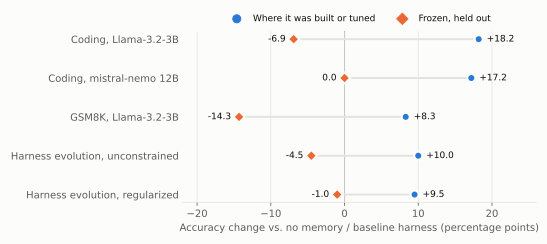
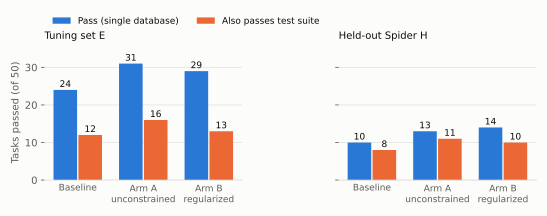
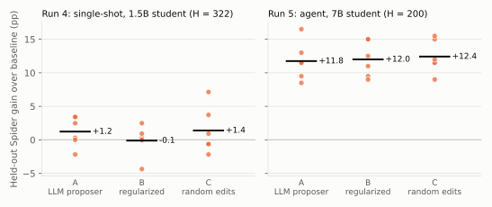

<!--
DRAFT, not published. Every number is taken from docs/FINDINGS_CODING.md,
docs/FINDINGS_REASONING.md, rsi_pilot/README.md, rsi_pilot/PROJECT_REPORT.md,
docs/PROJECT_NOTES.md, rsi_pilot/runs_pooled_v2v3.md, rsi_pilot/runs_v4/pooled_seed_level.md,
rsi_pilot/runs_v5/seed_level.md or rsi_pilot/runs/audit.json; figures are regenerated by
docs/writeup/make_figures.py. Before publishing, work through the checklist at the end of
docs/WRITEUP_OUTLINE.md.

Not yet verified by opening the source (taken from the research doc or search snippets):
every arXiv id and the one-line claim attached to it (RRSI 2609.24972, HGM 2510.21614,
TTRL 2504.16084, TraceLift 2605.03862, DGM 2505.22954, SPENCE 2604.17771 and its
"most likely leaked" ranking). Open each before publishing.
-->

# Four ways a self-improvement loop fooled its own metric, and the one time it did not

I built a loop that lets a small language model recover from its own failures without
retraining. It watches the model's accuracy on a stream of problems, notices when accuracy
drops, asks a stronger model to repair the failures, checks the repairs by running them, and
feeds the good ones back into the small model's prompt as worked examples. The small model's
weights never change.

On every demo I ran, it worked. Accuracy dropped when the problems got harder and climbed back
after correction. Then I added the controls a result needs before anyone else should believe it:
held-out problems frozen before the first run, memory frozen before scoring, repeated runs,
paired tests, a stricter answer checker, a random-search control, and predictions written down
before the run. Across three domains and three harness-evolution runs, the gains did not survive.
In the fifth run they did, and the control that mattered most was the one I had added last: a
random-search arm that matched the LLM proposer in both pre-registered runs.

*Figure 1. Blue: accuracy change on the problems the memory or harness was built or tuned on.
Orange: change on held-out problems with the memory or harness frozen. Each row is one
student; the two points come from different problem sets, which is the point. The last two
rows are the pre-registered runs, arm A, averaged over six seeds. Sources in
`make_figures.py`.*

This post is about the four ways the loop's own measurements misled me, the control that
caught each one, and what two pre-registered runs then showed. The code, logs, and every
number below are in the [repository](https://github.com/RohanChavan0701/Chiron).

## The system

A harness runs a student model on a stream of problems and logs one record per attempt. A
detector keeps a rolling window of accuracy and fires when it drops past a threshold, so a
single bad answer never triggers it. A correction stage takes the failures in that window,
asks a stronger teacher model for a fix, executes the fix to verify it, and appends the
verified fixes to the student's few-shot examples. The student then continues on the same
stream with the new examples in its prompt. Adapters plug in text-to-SQL (Spider), coding
(MBPP+ and HumanEval+), and grade-school math (GSM8K).

The appeal is obvious: no training run, no GPU budget, and the student improves from its own
mistakes. Whether it actually improves is the question the rest of this post is about.

## 1. Same-stream recovery is not transfer

The first coding result looked like the thing I was trying to build. Student Llama-3.2-3B,
teacher MiniMax-M2.5. On the hard bucket of the stream, accuracy went from 0.273 without
memory to 0.455 with it, a gain of 18 points.

The questions scored after correction came from the same stream the memory was built from, so
many of them had a near-twin among the examples. When I scored the same student on a
hard-curriculum evaluation, where memory is built on one set of problems and scored on
another, accuracy was 0.111 without memory and 0.111 with it.

So I froze the memory and ran an ablation on 29 held-out hard problems:

| Memory | Accuracy |
|---|---:|
| None | 0.103 |
| Teacher examples | 0.034 |
| Knowledge-graph rules | 0.103 |
| Both | 0.034 |

The obvious explanation for a null is that the examples never reached the prompt. An injection
audit ruled that out: on average 2.93 examples were in every prompt, and no prompt had zero.
The memory was delivered, read, and did not help. The -0.069 against no memory was 2
discordant problems, McNemar p = 0.50, so I can't call it harm. I can call it no help.

**What caught it:** freezing memory and scoring on problems that were not used to build it.

**What I took from it:** a repair the teacher verified as correct and a repair the student can
use are different properties. I had been measuring the first and assuming the second.

## 2. Fixing the student made it worse

A 3B student might simply be too weak to use any example. That is testable. On the same 29
problems, a strong model (qwen3-coder) with no memory scored 0.931, against 0.034 for the 3B
student with memory: 26 of 29 discordant, p < 0.0001. The 3B student was below the floor.

So I swept students for one whose unaided accuracy sat in a band where learning could show up,
roughly 0.3 to 0.6:

| Student | Unaided accuracy | Verdict |
|---|---:|---|
| Llama-3.2-3B | 0.103 | Too weak |
| mistral-nemo (12B) | 0.414 | In band |
| Qwen3.5-4B | 0.552 | In band |
| gpt-oss-20b | 0.828 | Too strong |
| qwen3-coder | 0.931 | Too strong |
| qwen3-8b | 0.966 | Too strong |

Both in-band students got their own learning phase and their own frozen memory.

mistral-nemo showed the same pattern as the 3B student. The curriculum pass went from 0.414 to
0.586, a 17-point gain. The frozen ablation on the same memory showed nothing. Because the
provider is not perfectly deterministic even at temperature 0, I repeated the comparison four
times on 34 held-out problems. The per-repeat differences were +0.059, +0.029, -0.029 and
-0.059. The mean was exactly zero.

Qwen3.5-4B was worse. On 29 held-out problems, accuracy with examples fell from 0.552 to 0.310:
10 problems regressed, 3 improved, 95% CI [-0.473, -0.010]. Three repeats at temperature 0 on
34 problems gave a difference of -0.265 in every repeat. No noise explanation is available. The
memory deterministically harmed the student that was supposed to be able to use it.

The knowledge-graph rules channel never changed a single answer for any of the three
students.

Repetition also showed something the aggregate hides. Across nemo's four repeats, the
no-memory arm had the same score every time while 5 of 34 individual problems flipped between
runs and cancelled out. With memory injected, 11 of 34 flipped. Longer prompts put more
problems on a decision boundary. On this stack, any difference under about 6 points is noise
unless it holds across repeats.

**What caught it:** repeating at temperature 0 and counting per-problem flips before trusting a
single-run p-value.

## 3. A utility gate that passed validation and failed held-out

If teacher-verified isn't the same as useful, the fix seems clear: only keep a memory item if it
measurably helps the student. I implemented that on GSM8K with Llama-3.2-3B, which sits in band
at 0.467. For each candidate example, the gate measured the student's pass rate on a
validation slice with and without it, and kept only items with positive uplift. It kept 3 of 8
scored candidates and dropped every item with zero or negative uplift. The gate did its job.

The curriculum pass improved from 0.333 to 0.417. The frozen ablation on 28 held-out problems
went the other way: 0.321 without memory, 0.179 with it, 3 improved and 7 regressed, p = 0.34.
Not significant, and the direction is harm.

The injection audit explained part of it. On 43% of held-out prompts, the topic filter
selected none of the three kept examples. Uplift on the validation slice was real and did not
predict relevance on new problems.

**What caught it:** the same frozen ablation, plus the injection audit that showed why.

## 4. Self-improving the harness overfits the tuning set

The memory loop changes what the student sees. A more ambitious version changes how the
student is run: a proposer model reads the student's failures and edits its harness, meaning
the system prompt, schema format, number of sample rows, few-shot strategy, retry policy and
instruction suffix. This is the setup of recent work on self-improving agent harnesses, and I
tested two arms. Arm A is unconstrained. Arm B is a small reimplementation of three ideas from
regularized recursive self-improvement ([RRSI](https://arxiv.org/abs/2609.24972)): an edit
budget, a critic that rejects benchmark-specific edits, and a pruner that reverts fields that
don't earn their place.

The student was qwen2.5-1.5B and the proposer qwen2.5-14B, all local. Evolution ran on a tuning
set E of 50 hard Spider problems. Held-out set H was 50 hard Spider problems from databases not
in E, because Spider's dev split has only 20 databases and a random split would make H a near
re-test of E. Held-out set B was 50 problems from BIRD, a different benchmark. The runner
refuses to score any evolved harness on H or B until both arms have finished, and logs every
access.

Pooled over four runs:

| | E (tuned on) | H (held-out Spider) | B (BIRD) |
|---|---:|---:|---:|
| Arm A vs baseline | +20 tasks, p = 0.007 | -9, p = 0.20 | +1, p = 1.0 |
| Arm B vs baseline | +19 tasks, p = 0.014 | -2, p = 0.86 | +1, p = 1.0 |

*Net tasks (improved minus regressed) over 200 per set; exact sign test on summed discordant
tasks. The runs share models and task pools, so they are not fully independent, and pooling by
task overstates significance. The pre-registered runs below use the seed as the unit instead.*

Both arms reliably improve the set they are tuned on and neither improves held-out data. Arm B
loses less on H than Arm A, which is what RRSI predicts, but the difference between them is 7
tasks out of 200, p = 0.25.

That difference had looked much bigger at one point. The second run alone showed Arm B ahead of
Arm A on H by 18 points, 13 to 4, p = 0.049. I reported it as a lead to replicate. Two new seeds
gave -6 points and +2 points. It was noise.

Two more details matter. In one of three replicates, neither arm found any edit worth keeping
in 15 tries. And the critic, whose job was to reject benchmark-specific edits, rejected zero
candidates across all three replicates. In the first run, with a different critic model, it
had rejected generic edits instead. A critic that has never been checked against planted
examples is not a defense.

**What caught it:** splitting held-out data by database rather than by problem, guarding it in
code, and replicating the one significant result before believing it.

## The metric itself was wrong

Everything above assumes the checker that decides "correct" is right. For text-to-SQL it
compares the rows the predicted query returns to the rows the gold query returns, on one
database. I re-scored every pass from the first harness-evolution run on Spider's test-suite
databases, which run each query against many database variants.

*Figure 2. Passes in the first harness-evolution run before and after re-scoring on Spider's
test-suite databases. Source: `rsi_pilot/runs/audit.json`.*

About half of the passes on the tuning set were false positives. Many came from gold queries
that return no rows, where any query that also returns nothing passes; 5 to 9 of each
harness's tuning-set passes were of that kind. Under the stricter check, the tuning-set gains
shrank from 7 tasks to 4 for Arm A and from 5 to 1 for Arm B. The loop had been optimizing
partly against a checker it could satisfy by returning nothing.

From the second run on, problems whose gold query returns no rows are excluded, and test-suite
false positives fell to 2 to 4 out of 20 to 25 passes. Every task also records the verdict of
a second, independent checker, and the two disagreed once in the first run.

There is a second problem with the metric that no checker fixes. Spider 1.0 is likely in every
student's pretraining data; a 2026 study of text-to-SQL contamination
([SPENCE](https://arxiv.org/abs/2604.17771)) ranks it as the most likely to have leaked. That
affects all arms equally, so it doesn't explain the transfer gap, but it caps any absolute
claim. BIRD is the cleaner held-out set, which is why it is in the design.

**What caught it:** re-scoring passes against a stricter oracle and running two checkers on
every task.

## What two pre-registered runs showed

Everything up to here was designed after seeing the previous result. Four reviewers (automated,
but independent of each other and of me) read the project between runs 3 and 4 and said the
same things: the unit of analysis should be the seed, not the task; tuning-set gains are true
by construction, so measure fresh tasks from the same pool; there was no random-search
control; and nothing was pre-registered. Runs 4 and 5 fix all four.

Both runs share one design. Three arms per seed. **Arm A** is the LLM proposer with a greedy
keep rule: any edit that gains one task on the tuning set E is kept. **Arm B** is RRSI-lite:
an edit budget that shrinks from three fields to one, a keep threshold calibrated on placebo
edits (ten meaning-preserving rewordings of the system prompt, scored on E; the threshold is
the smallest gain that fewer than 5% of best-of-three placebos reach), a deterministic leak
check, a 32B critic that scored 20 of 20 on planted edits before every seed, and pruning.
**Arm C** makes random edits from menus written before any run, with Arm A's keep rule. If C
matches A, the proposer adds nothing over blind search plus best-of-three selection.

E is drawn from Spider's train split per seed. A fresh set E2 from the same databases is
scored but never shown to the proposer, so E minus E2 measures how much of the tuning gain
was selection. H is Spider dev (whose databases are disjoint from train by construction) and
B is BIRD Mini-Dev. The proposer and critic are qwen2.5-32B. The unit of analysis is the seed:
per seed, net tasks (improved minus regressed) per comparison, then an exact two-sided
Wilcoxon signed-rank across seeds. With six seeds the smallest possible p is 0.031, and only
if every seed agrees. The primary endpoint, fixed in advance, is Arm B against Arm A on H.
Secondary endpoints are Holm-corrected.

The predictions for both runs were written by the AI coding assistant I worked with, at my
request, and I did not edit them. The files say so.

### Run 4: the single-shot harness, at scale, with controls

Same 1.5B student and nine-field harness as runs 1 to 3. E and E2 are 100 tasks each; H is
all 322 eligible hard Spider dev tasks; B is all 398 eligible BIRD tasks. Ten generations of
three candidates per arm. Six seeds, on three A10s in parallel, for $17.43.

| Endpoint | Set | Mean | 95% CI over seeds | p | p (Holm) |
|---|---|---:|---|---:|---:|
| **B vs A (primary)** | H | -4.3 tasks | [-13.7, +2.7] | 0.56 | |
| A vs baseline | H | +4.0 | [-1.5, +8.8] | 0.19 | 1.00 |
| B vs baseline | H | -0.3 | [-6.5, +4.3] | 0.88 | 1.00 |
| A vs C | E | +1.7 | [-1.5, +4.7] | 0.44 | 1.00 |
| A vs C | H | -0.5 | [-10.8, +9.5] | 1.00 | 1.00 |
| Selection gap, A (E gain minus E2 gain) | | +7.5 pp | [+1.7, +14.3] | 0.062 | 0.50 |

The primary endpoint is null, and the sign is the wrong way for regularization. Every arm
gained four to nine tasks of 100 on E and kept -0.2 to +2.2 of it on fresh E2 tasks from the
same databases. Arm A's selection gap was positive in five of six seeds and zero in the sixth,
which left five seeds in the test and a floor of p = 0.0625, so the endpoint could not reach
significance however it came out. No arm moved held-out Spider or BIRD beyond noise. Random
edits matched the LLM proposer on every set.

Two things the pre-registration did not predict. Meaning-preserving rewordings of the prompt
moved E by up to +8 tasks; in one seed a harmless rewording (+5) beat Arm A's whole evolved
harness (+4). And the cost of the edits that did get kept ran from 478 to 8,053 tokens per
held-out task for Arm A, against about 480 for the baseline, with no held-out gain to show for
it. Of the four predictions, one held (A no better than C), one partly held (B vs A not
significant, but B behind rather than ahead), and two did not.

**What caught it:** fresh tasks from the same pool (E2), which turned "tuning-set gain" into
a measured quantity, and the random arm.

### Run 5: a multi-step agent with room to improve

Run 5 changes the harness, not the method. The student is qwen2.5-7B running as a tool-using
agent: it lists tables, describes them, runs trial queries, and submits an answer. The eight
editable fields are the system prompt, a tool guide, a free-text `rules` memory shown before
every task, how much schema to show up front, sample rows in `describe`, result preview
length, step budget, and whether to verify before submitting. The baseline shows only table
names, has empty rules, six steps, no sample rows and no verification. E and E2 are 50 tasks;
H is a fixed 200 of the 322; B is a fixed 200 of the 398. Eight generations of three. Six
seeds, about 1 h 50 min each on one A10.

Mean over six seeds, accuracy with the gain in tasks in brackets:

| Harness | E (of 50) | E2 (of 50) | H (of 200) | B (of 200) | Tokens per H task |
|---|---:|---:|---:|---:|---:|
| baseline | 50.0% | 45.3% | 46.4% | 20.1% | 1,990 |
| A (unregularized) | 72.7% (+11.3) | 68.0% (+11.3) | 58.2% (+23.5) | 36.7% (+33.2) | 4,969 |
| B (RRSI-style) | 68.7% (+9.3) | 68.0% (+11.3) | 58.4% (+24.0) | 35.8% (+31.3) | 1,918 |
| C (random edits) | 74.3% (+12.2) | 67.3% (+11.0) | 58.8% (+24.8) | 36.6% (+33.0) | 3,930 |

| Endpoint | Set | Per-seed net tasks | Mean | p | p (Holm) |
|---|---|---|---:|---:|---:|
| **B vs A (primary)** | H | -4, +1, +4, +3, +2, -3 | +0.5 | 0.84 | |
| A vs baseline | H | +23, +17, +26, +19, +23, +33 | +23.5 | 0.031 | 0.25 |
| B vs baseline | H | +19, +18, +30, +22, +25, +30 | +24.0 | 0.031 | 0.25 |
| A vs C | H | -7, -1, +3, -4, -1, +2 | -1.3 | 0.53 | 1.00 |
| A vs C | E | +1, -3, 0, -2, 0, -1 | -0.8 | 0.38 | 1.00 |
| Selection gap, A | | +12, +12, -18, -6, -8, +8 pp | 0.0 pp | 0.88 | 1.00 |

This time the gains transferred. Both LLM arms gained about 12 points on held-out Spider,
positive in six of six seeds, and every arm improved BIRD in every seed (A +23 to +43 tasks,
B +9 to +45, C +19 to +44; BIRD gain was not a pre-registered endpoint, so that is
descriptive). The selection gap was zero: gains on E carried over to fresh E2 tasks in full.

*Figure 3. Per-seed held-out Spider gain over the baseline harness for the three arms, six
seeds each. Bars are means. Source: `runs_v4/s*/results.json`, `runs_v5/s*/results.json`.*

Three of the four predictions were wrong. The assistant had predicted no transfer (no arm's
held-out gain above 2%), a positive selection gap in at least five seeds, and that Arm A would
keep a leaky edit in at least two seeds. Instead: +12 points, a zero gap, and no flagged edit
kept. The leak check flagged 12 candidates across all arms, but 11 were false positives on
common words that happen to be tuning-set table names (`match`, `list`), and the one genuine
flag, Arm A writing the tuning-set columns `customerid` and `product_id` into `rules`, was not
kept because it did not score. The one prediction that held, B vs A not significant, held with
a size of +0.5 tasks rather than the predicted +3.

What the arms did explains the result. The baseline agent saw only table names. In five of six
seeds Arm B's main edit was `schema_upfront: full`; Arm A and Arm C each found it in three of
six, and the other seeds used sample rows in `describe`, verification, or more steps. The
missing piece was general information about the database, and every search procedure found a
way to supply it. "Self-improvement transferred" here means "the loop found a missing default",
not that it learned a strategy.

Arm B's extra machinery rejected nothing: the critic, the leak check and the field budget
together refused zero of 143 scored candidates, because the proposer stayed within the budget
on its own. What regularization did change is cost. Arm B changed one or two fields per seed
and ended at 1,918 tokens per held-out task, below the baseline's 1,990. Arm A rewrote `rules`
in every seed, turned on verification in every seed, changed about six fields, and ended at
4,969 tokens per task, 2.6 times more, for the same accuracy. Token cost was not a
pre-registered endpoint, so that is exploratory. It was larger for A in six of six seeds.

**What caught it:** nothing, this time. The controls were all in place before the run, and the
result passed them. That is what they are for.

## Random search matched the proposer, twice

The finding I did not expect to be the main one. In run 4 the 32B proposer beat random edits by
1.7 tasks of 100 on the tuning set and lost by 0.5 tasks of 322 on held-out data. In run 5 it
lost by 0.8 on the tuning set and 1.3 of 200 on held-out. Neither is close to significant.
Where there was nothing to find (run 4), the proposer found nothing; where there was one large
missing default (run 5), best-of-three random edits over the same eight fields found it just
as often.

Without Arm C, run 5 would have read as "an LLM proposer improved a 7B agent by 12 points on
held-out data". That sentence is true. It is also true of a random number generator. In an
edit space of eight or nine fields, the keep rule is doing the work, and the proposer's
intelligence adds nothing measurable at this scale. Whether a frontier proposer in a
source-code edit space does better is the obvious next question, and it is not one these runs
can answer.

## What I would tell someone building one of these

1. **Freeze the held-out set before the first run, and make the code refuse to touch it.** A
   convention you intend to follow is not a control.
2. **Freeze memory before scoring.** Recovery on the stream the memory was built from is a demo.
3. **Repeat at temperature 0 and count per-problem flips.** Aggregate accuracy was identical
   across four runs while 5 of 34 problems changed answers, and 11 of 34 once memory was added.
4. **Measure memory by what it does for the student, on problems it wasn't selected on.** Teacher
   correctness and validation uplift both passed and both failed to predict held-out benefit.
5. **Check the checker before optimizing against it.** Half the passes the optimizer was chasing
   were artifacts of empty gold results.
6. **Score fresh tasks from the tuning pool.** E minus E2 is the only direct measurement of
   selection I have, and it went from +7.5 points in run 4 to 0 in run 5.
7. **Run a random-search arm with the same keep rule.** It cost one more process per seed and
   changed what the headline result means.
8. **Write down predictions before the run, and publish the misses.** Five of eight were wrong.
   The runs that had predictions are the only two I would ask anyone to believe.

## What is still open

A poisoning audit is designed, implemented, tested and pre-registered: a few tuning tasks
carry a triggered directive, and the question is whether it reaches the evolved harness,
whether Arm B's checks stop it, and whether it survives pruning. Run 4's arms are its clean
control. It has not been run.

Two run-4 analyses were done after the fact and need their own pre-registration before they
are claims. Re-scoring run 4's held-out passes on Spider's test-suite databases removed about
31% of the baseline's passes as false positives, and under that stricter check Arm A and Arm C
both look better than baseline on H while Arm B looks worse than A. And the BIRD hand-label
sheets that every run has written are still unlabelled.

The run-5 result rests on a weak baseline. The next experiment that would say something new
is run 5 again with the full schema shown from the start, to see whether anything beyond
"finding missing defaults" transfers; and a frontier-model proposer, to see whether a better
proposer beats random edits when the space is small.

## Related work

[RRSI](https://arxiv.org/abs/2609.24972) supplied the regularization ideas Arm B borrows; at
this scale they changed cost, not accuracy. The
[Huxley-Gödel Machine](https://arxiv.org/abs/2510.21614) argues that a candidate's score on
the tuning benchmark is a poor predictor of its potential for further self-improvement, which is
the gap Figure 1 shows in run 4 and does not show in run 5. [Test-time RL](https://arxiv.org/abs/2504.16084)
shows a self-generated reward signal collapsing on hard cases, the same shape as the empty-gold
false positives. [TraceLift](https://arxiv.org/abs/2605.03862) motivates measuring memory by its
effect on the consumer, which section 3 implements and finds necessary but not sufficient. The
[Darwin Gödel Machine](https://arxiv.org/abs/2505.22954) is the positive result in this space;
this work does not reproduce anything like it at the scale of a 1.5B to 12B student and a 14B
to 32B proposer, and does not claim the method fails at frontier scale.

## Limitations and deviations

Small students (1.5B to 12B) and small proposers (14B, then 32B), against the frontier models
and source-level edits of the papers this work is modelled on. An edit space of eight or nine
fields. Fifty problems per set in runs 1 to 3; six seeds in runs 4 and 5, which is the smallest
number for which the pre-registered test can reach p < 0.05, and the Holm-corrected p for run
5's transfer endpoints is 0.25. The held-out sets are fixed across seeds, so seeds replicate
the search, not the test set. One proposer family. Spider contamination, as above. Run 5's
baseline was weak by construction, which is the most likely reason it is the run that
transferred.

Deviations from the pre-registrations, all recorded in the repository: run 4's prediction
file was pushed eight minutes after the first seed started, when only its baseline numbers
existed; run 4 was cut from ten seeds to six before any seed finished; one run-4 seed was
restarted from scratch after a pause, and in another only the crashed arm C was rerun rather
than the whole seed. Run 5's prediction file was committed locally before any result but
reached GitHub after the first seed had finished, so seeds 2 to 6 are pre-registered publicly
and seed 1 rests on the local commit time. Run 5's design was cut (60 to 50 tasks, 10 to 8
generations) before its pre-registration commit.

None of this says self-improvement loops can't work. It says that at this scale, the loop
transferred exactly when the baseline was missing something general, that a random search
found the same thing, and that every tool which showed this is cheap enough that there is no
reason to skip it.
