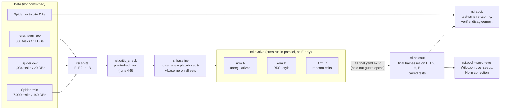
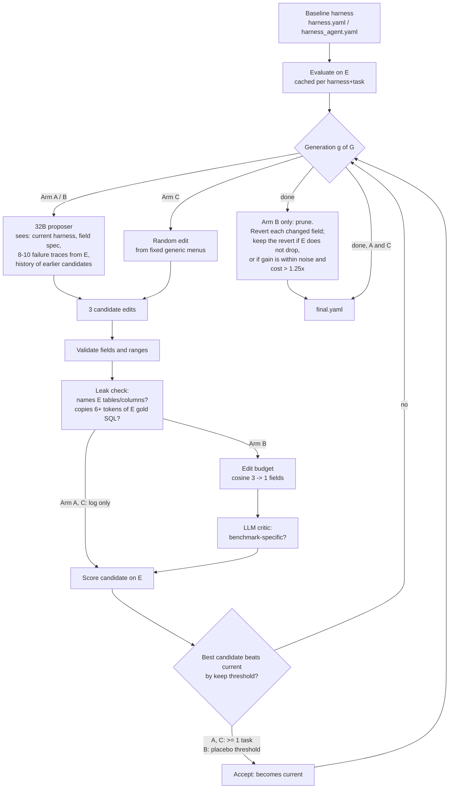
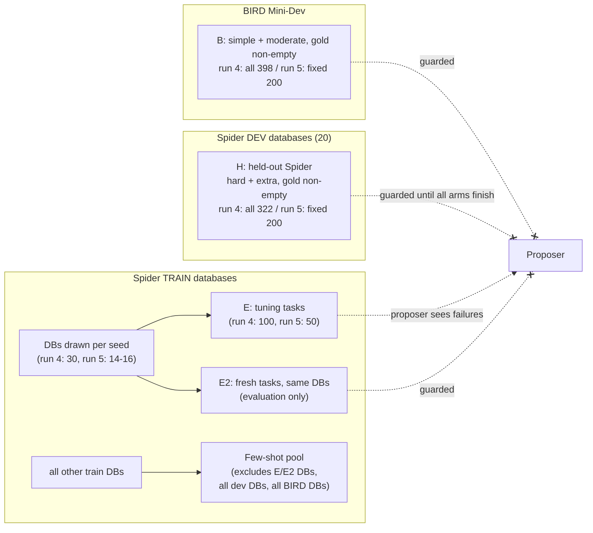
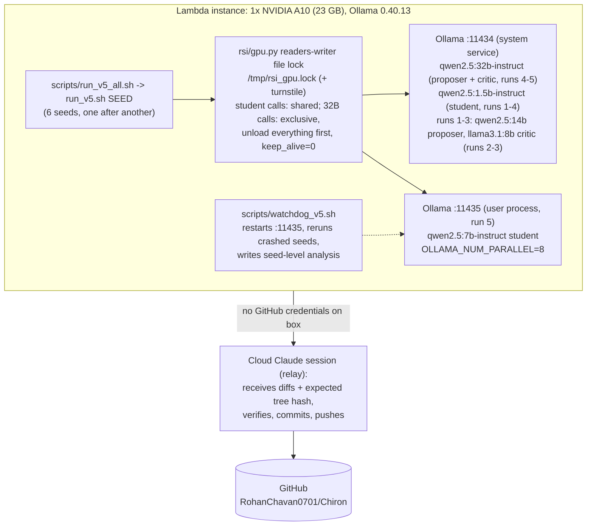

# Project report: Regularized self-improvement of an agent harness (rsi_pilot)

Status as of 2026-11-03, 14:00 UTC. This report covers everything built and run in `rsi_pilot/`:
- the system architecture
- every run (1-5), with its configuration and results
- the integrity controls
- the infrastructure problems found
- the deviations from plan
- where every file lives

The numbers come from the committed result files (`runs*/results.md`, `runs_v5/summary.csv`,
`runs_v5/seed_level.md`, `runs_pooled_v2v3.md`, `noise_floor.json`, `critic_check.json`,
`arm_*/log.jsonl`).

---

## 1. One-paragraph summary

**Question.** When an LLM repeatedly edits an agent's harness (prompts, tool guide, memory,
settings) to raise its score on a tuning set, do the gains carry over to unseen databases and
to a different benchmark? And does RRSI-style regularization change that?

**Paper.** "Regularized Recursive Self-Improvement of Agent Harnesses", arXiv 2609.24972.

**Runs 1-3** used a single-shot text-to-SQL harness with 9 settings and a 1.5B model.
- Tuning-set gains did **not** transfer.
- About half of run 1's tuning-set "passes" were false positives.

**Run 5** was pre-registered, with 6 seeds, a multi-step SQL agent on a 7B model and a 32B local proposer.
- Self-improvement **did** transfer: about +12 points on 200 held-out Spider tasks, positive in
  6 of 6 seeds for both LLM arms.
- A **random-edit control did just as well** as the LLM proposer.
- Regularization did **not** change accuracy. It did keep the harness at baseline cost:
  1,918 tokens per task, against 4,969 for the unregularized arm (exploratory).

**Run 4** (pre-registered, single-shot) is paused during seed 1.

---

## 2. Where this sits in the repository

```
Chiron/                          (repo: github.com/RohanChavan0701/Chiron)
├── CLAUDE.md, harness/, detector/, correction/, viewer/, contracts/
│     The original AgentWatch hackathon project: drift detection + self-improvement
│     loop for a text-to-SQL agent on Spider. rsi_pilot imports only one thing from
│     it: the AgentWatch result checker (harness/evaluator.py), used as the verifier
│     in runs 1-3.
└── rsi_pilot/                   This project (self-contained Python package `rsi`)
```

**Branches**
| Branch | Contents |
|---|---|
| `main` | Runs 1-3 (code and results), the run-4 design and pre-registration (e085db7), and run-4 Amendment 1 (5d1cf41) |
| `run5-agent` | Everything on `main` up to e085db7, plus the run-5 agent code and pre-registration (005c93a), plus the run-5 results commits (see §13 for push status) |

---

## 3. System architecture

### 3.1 End-to-end pipeline (one seed)



### 3.2 Inside one evolution arm



### 3.3 Data splits and leakage boundaries (runs 4-5)



Runs 1-3 used a different split: E and H both came from Spider **dev**, split by database,
with 50 tasks per set.

### 3.4 Compute and serving infrastructure (A10 box)



---

## 4. Components (`rsi_pilot/rsi/`, 21 modules, about 2,500 lines)

| Module | Purpose |
|---|---|
| `config.py` | Paths. `RSI_FROZEN`, `RSI_SPLITS`, `RSI_RUNS` and `RSI_HARNESS_KIND` select a run's config, splits, output directory and harness kind. `BASELINE` is the baseline harness file. |
| `data.py` | Loads Spider dev and train, and BIRD Mini-Dev, into one `Task` shape. Difficulty comes from Spider's official hardness classifier (vendored). |
| `splits.py` | Builds the E/H/B splits (runs 1-3; database-disjoint within Spider dev). `make_splits_v4` (runs 4-5) builds E and E2 from Spider train and fixed H and B sets. Options: drop tasks with empty gold results, cap tasks per database, take a fixed held-out subsample (`h_max`, `b_max`). |
| `schema.py` | Serializes a SQLite schema: CREATE TABLE or compact form, optional sample rows and foreign keys. |
| `fewshot.py` | Few-shot pool from Spider **train** only. Asserts that it shares no database with any evaluation set. Selection is fixed or lexical. |
| `harness.py` | The single-shot harness (runs 1-4): 9 editable fields, validation, prompt building, a retry loop. With `RSI_HARNESS_KIND=agent` it switches to the agent harness. |
| `agent.py` | The run-5 multi-step agent. Tools: `list_tables`, `describe`, `run_sql`, `submit`, plus optional verify-before-submit. 8 editable fields. |
| `student.py` | Ollama client for the student. Temperature 0, fixed seed, optional GPU lock. |
| `llm.py` | Proposer and critic clients: Ollama native API, OpenAI-compatible, or Anthropic. Refuses a prompt that may have been truncated by `num_ctx`. |
| `gpu.py` | Readers-writer GPU lock across processes and Ollama servers (see §8). |
| `sqlexec.py` | Read-only SQL execution with a timeout. Two checkers: AgentWatch's and Spider's official result comparison. |
| `runner.py` | Evaluates a harness on a split, caching results per harness and task. Contains the **held-out guard** and writes the access log. |
| `evolve.py` | The evolution loop for arms A, B and C: proposer prompt, leak check, edit budget, critic, keep rule, pruning. |
| `edits.py` | Random-edit menus (arm C), placebo prompts, the cosine edit budget, and the placebo keep threshold. |
| `leakcheck.py` | Deterministic leak check: flags tuning-set identifiers, or 6+ tokens copied from tuning-set gold SQL. |
| `critic_check.py` | Calibrates the critic on 10 planted leaky edits and 10 generic ones. |
| `baseline.py` | Noise repeats, placebo edits, and the baseline on every set. |
| `heldout.py` | Final evaluation: accuracy, paired bootstrap CIs, exact McNemar tests, transfer ratios. |
| `audit.py` | Re-scores passes on Spider's test-suite databases. Counts empty-gold passes and disagreements between the two checkers. Writes a BIRD hand-label sheet. |
| `stats.py` | McNemar test, paired bootstrap, transfer ratio. |
| `pool.py` | Pools runs. `--seed-level`: exact Wilcoxon signed-rank over seeds, Holm correction, bootstrap CI over seeds. |

**Tests.** 53 pass (`tests/test_components.py`, `test_pipeline.py`, `test_agent.py`). They use
synthetic databases and fake students and proposers, so they check plumbing, not results.

**Scripts.**
| Script | Purpose |
|---|---|
| `scripts/run_v4.sh`, `run_v4_all.sh` | Run 4: one seed, or all seeds |
| `scripts/stop_after_seed.sh` | Run-4 Amendment 1 |
| `scripts/run_v5.sh`, `run_v5_all.sh` | Run 5: one seed, or all seeds |
| `scripts/watchdog_v5.sh` | Overnight watchdog for run 5 |
| `scripts/plot_run5.py` | The headline figure |

### 4.1 The two harnesses (what evolution may edit)

**Single-shot harness** (`harness.yaml`, runs 1-4). Nine fields:

| Field | Values |
|---|---|
| `system_prompt` | text |
| `schema_format` | create_table, compact |
| `sample_rows` | 0-5 |
| `include_foreign_keys` | true, false |
| `fewshot_k` | 0-8 |
| `fewshot_rule` | fixed, lexical |
| `max_retries` | 0-3 |
| `feed_execution_errors` | true, false |
| `instructions_suffix` | text |

The baseline uses a one-line prompt, the CREATE TABLE schema, no sample rows, no few-shot
examples and no retries.

**Agent harness** (`harness_agent.yaml`, run 5). Eight fields:

| Field | Values |
|---|---|
| `system_prompt` | text, up to 6,000 chars |
| `tool_guide` | text, up to 3,000 chars |
| `rules` | memory text shown before every task, up to 4,000 chars |
| `schema_upfront` | none, tables, full |
| `describe_sample_rows` | 0-5 |
| `result_preview_rows` | 1-20 |
| `max_steps` | 2-12 |
| `verify_before_submit` | true, false |

The baseline shows only table names (`schema_upfront: tables`), empty rules, 6 steps, no
sample rows and no verification.

---

## 5. Integrity controls

1. **Database-disjoint splits.** E and H never share a database (asserted). In runs 4-5, E and
   E2 come from Spider train, and H comes from Spider dev, whose databases are disjoint from
   train by construction.
2. **Held-out guard** (`runner._guard_heldout`).
   - Any non-baseline harness is refused on H, B (and E2 in runs 4-5) until every arm has a
     `final.yaml`.
   - Every held-out evaluation is appended to `heldout_access.jsonl`.
   - Checked from the access logs: in runs 1-3 (by the code review) and in all 6 run-5 seeds,
     the first non-baseline held-out access came after every arm's `final.yaml` existed. The
     only purposes logged were `heldout_final` and `audit`.
3. **Proposer inputs.** The proposer sees only E failures. Gold SQL is hidden.
4. **Few-shot pool.** Spider train only, minus every dev, BIRD, E and E2 database. Spider train
   and BIRD share `formula_1`, so its 80 train examples were removed.
5. **Leak check.** Arm B enforces it; arms A and C only log it. Runs 4-5 also log, without
   acting on it, whether an edit names a held-out identifier.
6. **Critic calibration** (runs 4-5).
   - The 32B critic flagged 10/10 planted leaky edits and 0/10 generic ones, in every run-5
     seed and in run-4 seed 1.
   - In runs 2-3, the 8B critic had approved every candidate.
7. **Frozen settings.** Student temperature, seed, BIRD evidence hints, verifier and set sizes
   are in `frozen*.yaml`, which the loop cannot edit.
8. **Cache key.** From run 4 on (`cache_key_v2`), the cache key includes the eval settings, the
   seed and the few-shot pool fingerprint, so a cached result is never reused across settings.
9. **Pre-registration.** Run 4 is in `PREDICTION.md` (+ Amendment 1). Run 5 is in
   `PREDICTION_run5.md`. See §10 for the timing.
10. **Placebo-calibrated keep threshold** (Arm B, runs 4-5).
    - 10 meaning-preserving rewordings of the system prompt are scored on E.
    - The threshold is the smallest gain t for which P(best of 3 placebo edits ≥ t) ≤ 0.05.
    - The floor is 2 tasks.

---

## 6. Statistics

- **Within a run.** Paired tests on per-task pass/fail vectors: exact McNemar and a 95% paired
  bootstrap CI. These are uncorrected and descriptive.
- **Runs 2-3, pooled.** Exact sign test on summed improved/regressed tasks (`runs_pooled_v2v3.md`).
  This treats tasks as independent, which overstates significance (see §9).
- **Runs 4-5, pre-registered.**
  - The **seed** is the unit. For each seed, take net tasks (improved minus regressed) per
    comparison.
  - Test: exact two-sided Wilcoxon signed-rank across seeds.
  - The primary endpoint is fixed in advance. Secondary endpoints are Holm-corrected.
  - With 6 seeds, the smallest possible p is 2/64 = 0.031, and only if all 6 seeds agree.
- **Selection gap.** An arm's gain on E minus its gain on E2, in percentage points. This
  measures how much of the E gain came from selecting on E.

---

## 7. Runs: configuration and results

### 7.1 Run 1 (2026-11-02): single-shot pilot

**Configuration.**
- Student `qwen2.5:1.5b-instruct`; proposer and critic `qwen2.5:14b-instruct` (Ollama
  OpenAI-compatible API, default sampling, 4k context).
- E: 50 Spider-dev hard/extra tasks. H: 50 Spider-dev hard tasks from other databases. B: 50
  BIRD tasks.
- 5 generations × 3 candidates. Arm A unconstrained. Arm B: at most 2 fields, then 1; leak
  check; critic; pruning.
- Verifier: AgentWatch's checker.

| Harness | E | H | B |
|---|---|---|---|
| baseline | 48% | 20% | 10% |
| A | 62% | 26% | 8% |
| B | 58% | 28% | 12% |

**Findings.**
- No test reached p < 0.05.
- **Audit:** about half of E passes were test-suite false positives, many from gold queries
  that return no rows. Baseline 24 → 12, A 31 → 16, B 29 → 13.
- Arm B crashed once: a two-statement query raised `sqlite3.Warning`. The fix is in
  `sqlexec.py`; B was rerun, and the crashed log is kept.

### 7.2 Run 2: after the run-1 critique

**Changes from run 1.**
- Native Ollama API: seeded, temperature 0.7, 16k context.
- Critic `llama3.1:8b`.
- Edit history shown to the proposer.
- Cost-aware pruning.
- At most 6 tasks per database; empty-gold tasks excluded.
- 5 noise repeats.

| Harness | E | H | B |
|---|---|---|---|
| baseline | 40% | 58% | 6% |
| A | 48% | 46% | 6% |
| B | 50% | 64% | 10% |

**Findings.**
- B vs A on H: +18 points, 13/4, p = 0.049 (uncorrected). Treated as a lead, not a finding.
- Test-suite false positives fell to 2-4 of 20-25 passes.
- The critic approved every candidate.

### 7.3 Run 3: three seed replicates of run 2

These replicate run 2 with a minimum keep threshold of 2. Accuracy in %, 50 tasks per set:

| Run | Baseline E/H/B | A E/H/B | B E/H/B |
|---|---|---|---|
| run 2 | 40/58/6 | 48/46/6 | 50/64/10 |
| seed 20261103 | 40/56/16 | 56/60/22 | 58/54/16 |
| seed 20261104 | 38/50/6 | 54/40/2 | 48/42/4 |
| seed 20261105 | 46/54/8 | 46/54/8 | 46/54/8 (no edit kept) |

Pooled over runs 2-3 (sign test; net tasks out of 200):

| Comparison | E | H | B |
|---|---|---|---|
| A vs baseline | +20 (p = 0.007) | -9 (0.20) | +1 (1.0) |
| B vs baseline | +19 (0.014) | -2 (0.86) | +1 (1.0) |
| B vs A | -1 (1.0) | +7 (0.25) | 0 (1.0) |

**Conclusion of runs 1-3.**
- Tuning-set gains do not transfer.
- Run 2's B > A did not replicate.
- A later review showed that the pooled E p-values are mostly selection on E and that pooling
  by task overstates significance (see §9).

### 7.4 Multi-agent critique (between runs 3 and 4)

Four independent reviewer agents examined the project.

**Methodology and statistics.**
- The unit should be the seed.
- E gains are true by construction (selection).
- Power was too low: with n = 50, a 10-point effect had about 20% power.
- The noise floor measured the wrong noise.
- No pre-registration.

**Code correctness.**
- The published numbers reproduced exactly (450 cached outputs re-scored, 0 changes).
- Three small bugs, none affecting H or B:
  - a float comparison in the transfer ratio;
  - the audit counting "verified" when nothing had been checked;
  - the audit using a different checker from the one that scored the run.
- All three are fixed in e085db7.

**Fidelity to the paper.**
- The edit space was too small.
- The models were much weaker than the paper's.
- The search was smaller.
- Arm A already had a strict keep rule.

**Positioning.**
- The README buried the finding.
- There was no random-search control.
- Pre-registration was missing.

Runs 4 and 5 implement these fixes.

### 7.5 Run 4: single-shot, pre-registered (paused)

**Design** (`frozen_v4.yaml`, `PREDICTION.md`, pushed in e085db7).
- E and E2: 100 tasks each from Spider train.
- H: all 322 eligible Spider-dev hard/extra tasks. B: all 398 BIRD simple/moderate tasks.
- Arms A, B and C. Proposer and critic `qwen2.5:32b-instruct`. 10 generations × 3.
- Cosine budget 3 → 1. Placebo threshold. Spider's official checker.
- 10 seeds, cut to 6 by Amendment 1 (5d1cf41) before any seed finished.

**Status.**
- Paused at the user's request at 02:37 UTC, during seed 20261111's evolution, so run 5
  could use the GPU.
- The partial `arm_*` directories of that seed must be deleted before resuming.

**Seed 1 baseline.**
- E: 35 and 33 out of 100 on two repeats. E2 34/100. H 108/322 (33.5%). B 55/398 (13.8%).
- Placebo deltas on E: +3, +2, +4, +5, +2, +5, +2, +1, +5, +1, so Arm B's threshold was 6 tasks.

### 7.6 Run 5: multi-step SQL agent, pre-registered (complete)

**Design** (`frozen_v5.yaml`, `PREDICTION_run5.md`, pushed in 005c93a).
- Student `qwen2.5:7b-instruct` as a tool-using agent, on a second Ollama server with 8
  parallel slots.
- Proposer and critic `qwen2.5:32b-instruct`.
- E and E2: 50 tasks each from Spider train. H: a fixed 200 of the 322. B: a fixed 200 of the
  398.
- 8 generations × 3 candidates per arm. Arms A, B and C.
- Seeds 20261211-20261216.
- Ran 02:44-13:48 UTC on 2026-11-03, about 1 h 50 min per seed. No crashes; the watchdog never
  had to restart anything.

**Mean over 6 seeds.** Accuracy, with the gain in tasks in brackets.

| Harness | E (of 50) | E2 (of 50) | H (of 200) | B (of 200) | Tokens per H task |
|---|---|---|---|---|---|
| baseline | 50.0% | 45.3% | 46.4% | 20.1% | 1,990 |
| A (unregularized) | 72.7% (+11.3) | 68.0% (+11.3) | 58.2% (+23.5) | 36.7% (+33.2) | 4,969 |
| B (RRSI-style) | 68.7% (+9.3) | 68.0% (+11.3) | 58.4% (+24.0) | 35.8% (+31.3) | 1,918 |
| C (random edits) | 74.3% (+12.2) | 67.3% (+11.0) | 58.8% (+24.8) | 36.6% (+33.0) | 3,930 |

**Pre-registered seed-level analysis** (`runs_v5/seed_level.md`):

| Endpoint | Per-seed values | Mean | p | p (Holm) |
|---|---|---|---|---|
| **Primary:** B vs A on H | -4, +1, +4, +3, +2, -3 | +0.5 tasks | 0.844 | - |
| A vs baseline, H | +23, +17, +26, +19, +23, +33 | +23.5 | 0.031 | 0.250 |
| B vs baseline, H | +19, +18, +30, +22, +25, +30 | +24.0 | 0.031 | 0.250 |
| A vs C, E | +1, -3, 0, -2, 0, -1 | -0.8 | 0.375 | 1.000 |
| A vs C, H | -7, -1, +3, -4, -1, +2 | -1.3 | 0.531 | 1.000 |
| B vs A, B | +11, -16, -10, -15, +4, +15 | -1.8 | 0.719 | 1.000 |
| Gap A (E - E2, pp) | +12, +12, -18, -6, -8, +8 | 0.0 | 0.875 | 1.000 |
| Gap B | +4, +10, -16, -12, -12, +2 | -4.0 | 0.438 | 1.000 |
| Gap C | -2, +22, -8, +10, -8, 0 | +2.3 | 0.750 | 1.000 |

**Other measured facts.**
- **BIRD.** Every arm improved BIRD in all 6 seeds:
  - A: +23 to +43 tasks.
  - B: +9 to +45 tasks.
  - C: +19 to +44 tasks.
  - This is descriptive: arm vs baseline on B was not a pre-registered endpoint.
- **What the arms changed.**
  - B changed 1-2 fields per seed: `schema_upfront: full` in 5 of 6 seeds, otherwise
    `max_steps`, `describe_sample_rows` or `tool_guide`.
  - A changed about 6 fields per seed: it rewrote `rules` in all 6 seeds and turned on
    `verify_before_submit` in all 6. It used `schema_upfront: full` in only 3 of 6.
  - C used `schema_upfront: full` in 3 of 6.
- **Accepted edits** (48 generations per arm): A 23, B 7, C 18.
- **Arm B pruning.** It tested 17 changed fields and reverted 7 that did not help E.
- **Arm B rejections.** The critic, the leak check and the field budget rejected **0** of 143
  scored candidates. The proposer always kept within the budget.
- **Leak flags.** The leak check flagged 12 candidates: 8 in A, 0 in B, 4 in C.
  - Only one was genuine: in seed 1, generation 1, A named `customerid` and `product_id` in
    `rules`.
  - The other 11 were false positives on common words that are also tuning-set table names
    (`match`, `list`).
  - **No flagged edit was kept.**
- **Placebo keep thresholds for B** by seed: 3, 8, 4, 4, 2, 6 tasks. The placebo deltas ranged
  from -7 to +7 tasks of 50.
- **Noise.** Two baseline repeats on E scored (33, 34), (19, 19), (23, 24), (21, 21), (29, 31),
  (19, 21), with 2-7 tasks flipping.

**Pre-registered predictions against outcomes.**

| Prediction | Outcome |
|---|---|
| 1. B ahead of A on H by about 3 tasks, not significant | Not significant held (p = 0.84); the size was +0.5 |
| 2. A's selection gap is positive in at least 5 of 6 seeds | **Wrong:** 3 of 6, mean 0 |
| 3. A keeps a leaky edit in at least 2 of 6 seeds | **Wrong:** none kept |
| 4. No arm's mean held-out gain exceeds 2% | **Wrong:** about +12 points on H, +16 on B |

---

## 8. Infrastructure findings (useful for anyone running local-LLM experiments)

1. **Where Ollama places a model changes its outputs.**
   - With the 32B model resident, Ollama loaded the 1.5B student about 79% on the CPU.
   - The same harness then scored 36 and 39 out of 100.
   - Fix (`rsi/gpu.py`): a readers-writer file lock.
     - Student calls take it shared.
     - 32B calls take it exclusively, unload every model on every server first, and use
       `keep_alive=0`.
     - A turnstile stops student calls from starving the 32B calls.
     - A student call is retried if the student is not fully in VRAM.
2. **Residual nondeterminism.**
   - At temperature 0 with a fixed seed, about 1-2 tasks per 100 still flip between identical
     runs on one server slot.
   - With 8 parallel slots (run 5), 2-7 of 50 agent tasks flip, while net scores stay within
     ±2.
   - The placebo threshold and the seed-level analysis absorb this noise.
3. **GPU fit on a 23 GB A10.** The 32B proposer fits fully on the GPU at an 8k context and
   runs at about 22 tokens/s. At 12k or 16k it spills onto the CPU.
   - `llm.py` refuses any reply where prompt plus `num_predict` might exceed `num_ctx`, because
     Ollama would silently truncate the prompt.
   - Proposer prompts in run 5 peaked at 5,145 tokens, within the limit with `num_predict`
     1,536.
4. **Throughput.**
   - A single Ollama server effectively serialized the student: 4 client workers were no
     faster than 1.
   - A second user-level server with `OLLAMA_NUM_PARALLEL=8` made the agent about 4× faster
     (60 tasks in 45 s).
5. **The empty-gold trap.** When the gold answer is an empty result, any query that returns
   nothing passes. In run 1 this inflated tuning-set passes by about half. From run 2 on,
   these tasks are excluded.

---

## 9. Methodological lessons

- **Gains on the tuning set are selected, not measured.** Measure gains on fresh tasks (E2)
  and on held-out sets.
- **Use the seed, not the task, as the unit for pooled tests.** Pooling runs 2-3 by task gave
  p = 0.007 for E. That mostly reflects selection on E and non-independent tasks.
- **Calibrate the keep threshold with placebo edits.** Re-running the same harness measures
  almost no noise. Harmless rewordings moved E by up to ±7 of 50.
- **Always run a random-search control.** In run 5 it matched the LLM proposer. Without it,
  the gains would have been credited to the proposer's intelligence.
- **Check the critic before trusting it.** The 8B critic in runs 2-3 approved everything. The
  32B critic passed the planted-edit check. Even so, it never rejected a real candidate in
  run 5, so its effect there is untested.
- **Write predictions down and report the misses.** Three of run 5's four predictions were
  wrong.

---

## 10. Deviations and honesty log

| Run | Deviation |
|---|---|
| Runs 1-3 | No predictions were registered (`PREDICTION.md` was blank). The user asked to run without them. |
| Run 1 | Arm B was restarted after a crash; the crashed log is kept. The proposer was unseeded. Run-2 changes were designed after seeing run-1 results. |
| Run 4 | `PREDICTION.md` (written by the AI assistant, as the file states) was pushed at 02:25 UTC, 8 minutes after the run started; only baseline numbers existed then. Amendment 1 (10 → 6 seeds) was pushed before any seed finished. Run 4 was then paused. |
| Run 5 | `PREDICTION_run5.md` was committed locally at 02:50 UTC, before any result. It reached GitHub only at about 04:50 UTC, **after seed 1 finished (04:23)**, because the relay waited for the user's approval. Seeds 2-6 are pre-registered on GitHub; seed 1 rests only on the local commit time. |
| Run 5 | The design was cut before launch (E/E2 60 → 50, 10 → 8 generations) to fit the time. This happened before the pre-registration commit. |
| Run 5 | Token cost was not a pre-registered endpoint, so the "B keeps cost at baseline" finding is exploratory. |
| Run 5 README | Before pushing, I corrected two overstatements in my own draft: that every arm used the full-schema fix, and that the leakage prediction held. |
| All | Per-candidate logs and caches for runs 4-5 stay on the box and are not on GitHub (size). The BIRD hand-label sheet from run 1 was never labelled. |

---

## 11. Limitations

- **Small models** (1.5B and 7B students, a 32B proposer) and a **small edit space** (8-9
  fields), against the paper's frontier models and source-level edits. This is a small-scale
  extension, not a replication.
- **Weak run-5 baseline.** The baseline agent saw only table names, so much of the transfer is
  "finding missing general defaults".
- **Fixed held-out sets** across seeds. The seeds replicate the search, not the test set.
- **Small seed count.** 6 seeds is the minimum the test needs. Holm-corrected p for the
  transfer endpoints is 0.25.
- **Pretraining overlap.** Spider and BIRD are probably in the models' pretraining data. This
  affects all arms equally.
- **Leak-check false positives.** The checker flags common words that are also table names
  (`match`, `list`).

---

## 12. How to reproduce

```bash
cd rsi_pilot
python3 -m venv .venv && .venv/bin/pip install -r requirements.txt matplotlib
# data/spider, data/bird_minidev, data/testsuite (see README Setup)
ollama pull qwen2.5:1.5b-instruct qwen2.5:7b-instruct qwen2.5:32b-instruct
.venv/bin/python -m pytest tests -q                        # 53 tests

# Run 5 (agent): second Ollama server for the student, then 6 seeds
OLLAMA_HOST=127.0.0.1:11435 OLLAMA_NUM_PARALLEL=8 OLLAMA_MODELS=~/ollama2/models ollama serve &
OLLAMA_HOST=127.0.0.1:11435 ollama pull qwen2.5:7b-instruct
scripts/run_v5_all.sh                                      # ~11 h on one A10
RSI_HARNESS_KIND=agent .venv/bin/python -m rsi.pool runs_v5/s2026121? --seed-level
.venv/bin/python scripts/plot_run5.py                      # figures/run5_headline.png

# Run 4 (single-shot): resume after deleting runs_v4/s20261111/arm_*
scripts/run_v4_all.sh

# Runs 1-3: see README "Run order" (RSI_FROZEN / RSI_SPLITS / RSI_RUNS per run)
```

---

## 13. Commits and where things are

**GitHub `main`.**
| Commit | Contents |
|---|---|
| ec04b74, 5b0d36c | Pilot scaffold; free local proposer |
| 54d4572 | Few-shot pool drops `formula_1` |
| 90b2791 | `sqlite3.Warning` treated as an execution error |
| 6505cc7 | Run 1 results |
| 23888cc, ac6fafe | Run 2 settings and results |
| 3f28533, 30e648f | Run 3 replicates and logs |
| e085db7 | Run 4 design, critique fixes, `PREDICTION.md` |
| 5d1cf41 | Run 4 Amendment 1 (6 seeds) |

**GitHub `run5-agent`.**
- 005c93a: run 5 agent, config, scripts, `PREDICTION_run5.md`.
- Pending at the time of writing: the run-5 results commit, the figure commit, and this
  report with the README corrections. They need the user's approval in the relay session.

**Only on the A10 box.**
| Path | Contents |
|---|---|
| `~/Chiron_r5/rsi_pilot/runs_v5/s*/arm_*/log.jsonl` | Every candidate, decision and proposer reply (about 315 KB) |
| `runs_v5/s*/cache/`, `evals/` | Per-task records |
| `runs_v5/s*/results.json` | Full per-seed results |
| `splits_v5_s*.json`, `frozen_v5_s*.yaml` | Per-seed splits and configs; regenerable from the seed |
| `~/Chiron/rsi_pilot/runs_v4/s20261111/` | Partial run-4 seed (paused) |
| `runs_v2/evals`, `runs_v3_*/evals` | Earlier per-task dumps |

---

## 14. Honest one-line claims (for a CV or write-up)

- Built a pre-registered, leakage-controlled evaluation harness for self-improving LLM agents.
  It has database-disjoint held-out sets, a held-out access guard, a random-search control, a
  placebo-calibrated acceptance threshold, critic calibration, and seed-level statistics.
- Found that about 50% of tuning-set passes in a naive Spider setup were false positives
  (empty-gold results), and fixed the evaluation.
- Single-shot harness, 1.5B student: tuning-set gains of about +20 tasks did not transfer to
  held-out databases.
- Multi-step agent, 7B student, 6 seeds: self-improvement transferred, about +12 points on
  held-out Spider in 6 of 6 seeds. But a random-edit baseline matched the 32B LLM proposer,
  and RRSI-style regularization did not change accuracy. It did keep the harness 2.6× cheaper
  per task (exploratory).
- Found and fixed an Ollama CPU/GPU placement effect that silently changed model outputs in
  multi-model local experiments.

## 15. Possible next steps

1. Resume run 4, about 11 h for 6 seeds, to get the pre-registered single-shot result with the
   same controls.
2. Run 5 with a stronger baseline (full schema from the start) to test whether anything beyond
   "finding missing defaults" transfers.
3. Use a frontier proposer (Claude) to test whether the LLM can beat random search when its
   ideas are better.
4. Put a GitHub token on the box so full logs can be pushed without the relay.
5. Write a short report and contact the RRSI authors with the random-search and
   cost-regularization findings.
