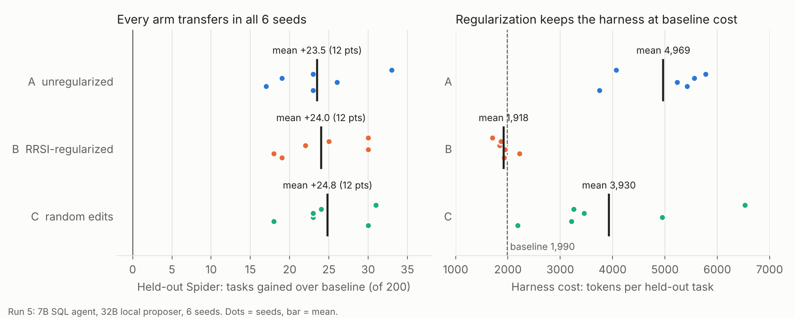

# Regularized RSI pilot (AgentWatch / Chiron)

**Question.** When an LLM rewrites an agent's harness to score better on a tuning set,
do the gains transfer to unseen databases and to another benchmark? And does RRSI-style
regularization change that?

## TL;DR (run 5, pre-registered, 6 seeds)



The agent is a multi-step SQL agent on a 7B model; the proposer is a local 32B model.
The agent lists tables, describes them, runs trial queries, then submits an answer.
Three arms evolve its harness on 50 Spider-train tasks:
- **A** keeps any edit that helps.
- **B** is RRSI-style: a shrinking edit budget, a placebo-calibrated keep threshold, a leak
  check, an LLM critic and pruning.
- **C** applies random edits with A's keep rule (a control).

Main results:

1. **Self-improvement transferred.**
   - Held-out Spider (200 tasks, unseen databases): A gained +23.5 tasks and B +24.0 tasks
     over the baseline harness, about +12 points.
   - Both arms were positive in 6 of 6 seeds (exact Wilcoxon p = 0.031 each, Holm 0.25).
   - BIRD improved too.
   - Runs 1-4 had a 9-knob single-shot harness and a 1.5B student, and their gains did not
     transfer. The difference is headroom: the baseline agent was missing general
     information, and every arm found a way to supply it.
     - The most common fix was showing the full schema up front: B in 5 of 6 seeds, A and C
       in 3 of 6. The baseline showed only table names.
     - The other seeds used sample rows in `describe`, `verify_before_submit` or more steps.
2. **Regularization did not change accuracy (primary endpoint).** B vs A on held-out
   Spider: +0.5 tasks per seed, p = 0.84. On BIRD: -1.8 tasks, p = 0.72.
3. **Regularization kept the harness small (exploratory; not pre-registered).**
   - B used 1,918 tokens per held-out task, against 1,990 for the baseline. A used 4,969, or
     2.6x more; A was larger in 6 of 6 seeds.
   - B changed 1-2 fields per seed (`schema_upfront: full` in 5 of 6 seeds).
   - A changed about 6 fields per seed: it rewrote `rules` in every seed, always turned on
     `verify_before_submit`, and added steps.
4. **The LLM proposer was no better than random edits.**
   - C gained +24.8 on held-out Spider.
   - A vs C was -1.3 tasks on held-out Spider (p = 0.53) and -0.8 on the tuning set
     (p = 0.38).
   - In this edit space, selecting the best of a few random edits finds the same fixes.
5. **No selection gap.** The difference between tuning-set gain and gain on fresh tasks
   from the same databases averaged 0 pp for A, with Holm-corrected p ≈ 1.

**Most of my predictions were wrong.** They are in `PREDICTION_run5.md`, written before the
run.

| Prediction | Result |
|---|---|
| 1. B beats A on H by about 3 tasks, not significantly | Not significant held (p = 0.84); the size was +0.5 tasks |
| 2. A has a selection gap in at least 5 of 6 seeds | Wrong: 3 of 6 |
| 3. A keeps a leaky edit in at least 2 of 6 seeds | Wrong: no flagged edit was kept |
| 4. No arm gains more than 2% on H or B | Wrong: about +12 points on H |

On prediction 3, the leak check flagged 12 candidates: 8 in A, 0 in B and 4 in C.
- Only one was genuine. In seed 1, generation 1, A wrote the tuning-set columns
  `customerid` and `product_id` into `rules`, and that edit was not kept.
- The other 11 were false positives on common words that happen to be tuning-set table
  names: `match` (7 in A, seed 6) and `list` (4 in C).

Full numbers are in [Run 5](#run-5-multi-step-sql-agent-pre-registered) and
`runs_v5/seed_level.md`.

**Earlier runs.** Runs 1-3 used a single-shot 1.5B student, 50-task sets and up to 4 seeds.
Tuning-set gains did not transfer, and about half of run 1's tuning-set passes were false
positives under Spider's test suites. Run 4 (single-shot, pre-registered, 10 → 6 seeds) is
paused during seed 1 (see [Run 4](#run-4-paused)). The lab log for runs 1-3 follows.

Inspired by RRSI (Regularized Recursive Self-Improvement of Agent Harnesses, arXiv
2609.24972). This repo does not use RRSI's code. Arm B reimplements four of its ideas at small
scale:
- an annealed edit budget;
- a critic against benchmark-specific edits;
- pruning;
- a noise-calibrated acceptance threshold.

# Lab log: runs 1-3 (single-shot harness, 1.5B student)

**Status of runs 1-3.**
- Run 1 was a null result.
- Run 2, after a critique of run 1, found B vs A on H with p = 0.049, uncorrected.
- Run 3, three replicates of run 2, did not reproduce that result. Tuning-set gains
  reliably failed to transfer in both arms.
- These runs used n = 50 per set and a 1.5B student. Runs 1 and 2 had one seed each; run 3
  added three.

## Design

| Set | Source | Role |
|---|---|---|
| E | 50 Spider dev tasks, hard/extra | Evolution only |
| H | 50 Spider dev tasks, hard, **from databases not in E** | Held out |
| B | 50 BIRD Mini-Dev tasks (SQLite) | Held out, different benchmark |

E and H are split by `db_id` because Spider dev has only 20 databases; a random split
would make H nearly the same test as E.

| Arm | Edits per candidate | Selection |
|---|---|---|
| A: unconstrained | Any number of fields | Best E score |
| B: regularized | At most 2 fields, 1 from generation 4 | Deterministic leak check + LLM critic reject benchmark-specific edits; after the run, revert any field whose removal does not lower E |

Both arms: 5 generations x 3 candidates, 10 failure traces shown per generation, and a
candidate is kept only if it beats the current harness on E by at least the noise floor
(spread across 3 baseline runs) + 1 task.

### Leakage controls

- The runner refuses to run any non-baseline harness on H or B until both arms have
  `final.yaml`, and logs every H/B evaluation to `runs/heldout_access.jsonl`.
- The proposer sees only E failures. Gold SQL is hidden from it by default
  (`show_gold_sql_to_proposer: false`).
- Few-shot examples come from Spider train only; the pool asserts it shares no
  database with E, H or B.
- Student temperature, seed, and whether BIRD's evidence hint is included are in
  `frozen.yaml` and cannot be edited by the loop.
- Arm A's edits are leak-checked too (logged, not enforced), so the README can report
  how often unconstrained evolution named benchmark identifiers.

### Verifier

The default verifier is AgentWatch's own checker (`../harness/evaluator.py`, imported,
not copied), as the plan specifies. It lowercases and string-casts values, allows no
column reordering, and compares duplicate-sensitive sorted lists (its docstring says
frozensets; the code sorts lists). The alternative, `verifier: spider_official`, is
Spider's comparison vendored from taoyds/test-suite-sql-eval (Apache 2.0): typed values,
column permutation allowed, bag semantics. Every task records both verdicts, and the audit
reports how often they disagree. Test-suite re-scoring always uses Spider's comparison.
Both check row order only when the gold query has ORDER BY. DISTINCT is kept.

## Setup

```bash
python3 -m venv .venv && .venv/bin/pip install -r requirements.txt
```

Data (not committed):

- `data/spider/`: `dev.json`, `train_spider.json`, `tables.json`, `database/<db_id>/<db_id>.sqlite`
- `data/bird_minidev/`: the Mini-Dev SQLite json and `dev_databases/<db_id>/<db_id>.sqlite`
- Optional for the audit: Spider test-suite databases (`database/` folder from test-suite-sql-eval)

Student: `ollama pull qwen2.5:1.5b-instruct` (confirm it matches the AgentWatch tag in
`frozen.yaml`). To run arms in parallel or use `--workers > 1`, start Ollama with
`OLLAMA_NUM_PARALLEL` set, and check the noise floor afterwards: parallel batching can
break determinism.

Proposer: free and local by default, `qwen2.5:14b-instruct` served by the same Ollama
instance as the student (`ollama pull qwen2.5:14b-instruct`), through Ollama's
OpenAI-compatible API. Fixed weights keep the run reproducible. It fits beside the student
on a 24 GB GPU such as an A10. A 14B proposer is much weaker than the frontier models the
RRSI and HarnessCompass papers used, so a null result may reflect proposer quality; say so
in the write-up. Alternatives in `frozen.yaml`: an OpenRouter free model (free models rotate
and are rate-limited; record the exact model name), or Claude via the Anthropic SDK.

## Run order

Run everything from `rsi_pilot/`; the AgentWatch verifier is imported from the repo root.

```bash
.venv/bin/python -m pytest -q                      # 32 plumbing tests, synthetic data
.venv/bin/python -m rsi.splits                     # writes splits.json
git add PREDICTION.md && git commit -m "Predictions"   # fill it in first
.venv/bin/python -m rsi.baseline                   # noise floor on E x3, baseline on E/H/B
.venv/bin/python -m rsi.evolve --arm A             # run A and B in two terminals
.venv/bin/python -m rsi.evolve --arm B
.venv/bin/python -m rsi.heldout                    # results.md, results.json
.venv/bin/python -m rsi.audit --testsuite-dir path/to/test-suite/database
```

`rsi.baseline` warns if the E baseline is outside 15% to 80%, if B is below 5% (then
rerun `rsi.splits --bird-fallback` and record it), or if a task takes over 2 s.

## Outputs

- `splits.json`, `runs/noise_floor.json`
- `runs/arm_{A,B}/log.jsonl`: every proposal, leak check, critic verdict, score and decision
- `runs/arm_{A,B}/final.yaml`, `summary.json`
- `runs/results.md`: accuracy per harness and set; deltas with paired 95% bootstrap CIs;
  improved/regressed counts; exact McNemar p for A vs baseline, B vs baseline, and B vs A
- `runs/audit.json`, `runs/audit_bird_labels.csv` (20 BIRD passes to hand-label)

## Reading the results

- Exact McNemar with n=50 needs at least 6/0 for p < 0.05 (5/0 gives 0.0625). Nine tests are
  reported uncorrected; treat a single p-value as weak evidence. A null is the expected outcome.
- Report raw gains with CIs first. The transfer ratio is secondary: E gain is the best of
  up to 15 candidates on the same 50 tasks, so it is inflated, and the ratio is reported as
  None when E gain is under 2 tasks.

## Results

Run on 2026-11-02 on one NVIDIA A10 (Lambda), Ollama 0.40.13, student `qwen2.5:1.5b-instruct`,
proposer and critic `qwen2.5:14b-instruct`. One seed, n=50 per set. Raw outputs:
`runs/results.md`, `runs/results.json`, `runs/audit.json`, `runs/arm_{A,B}/`, `splits.json`.

**Headline: a null result.** No comparison reaches p < 0.05, and no confidence interval
excludes zero or a loss. Arm B kept more of its E gain on held-out Spider than Arm A, but the
difference is one or two tasks.

| Harness | E (tuned on) | H (held-out Spider) | B (BIRD) | prompt tokens/task (H) |
|---|---|---|---|---|
| baseline | 48% | 20% | 10% | 321 |
| arm_A (unconstrained) | 62% | 26% | 8% | 428 |
| arm_B (regularized) | 58% | 28% | 12% | 606 |

| Comparison | E | H | B |
|---|---|---|---|
| A vs baseline | +14% [+0, +28], 10/3, p=0.092 | +6% [-6, +18], 6/3, p=0.51 | -2% [-12, +6], 2/3, p=1.0 |
| B vs baseline | +10% [+0, +20], 6/1, p=0.125 | +8% [-2, +18], 6/2, p=0.29 | +2% [-4, +8], 2/1, p=1.0 |
| B vs A | -4% [-16, +8], 4/6, p=0.75 | +2% [-4, +10], 2/1, p=1.0 | +4% [-6, +14], 4/2, p=0.69 |

Cells: delta, paired 95% bootstrap CI, improved/regressed tasks, exact McNemar p (uncorrected).
Transfer ratio (secondary): A: H 0.43, B -0.14; B: H 0.80, B 0.20.

**What evolution kept.** Arm A kept one edit (generation 2): a rewritten system prompt that
asks for "one or more SQLite queries", 1 sample row per table, and foreign keys turned off.
Arm B ended with one field changed, `sample_rows: 3`; pruning reverted `max_retries` because
removing it did not lower E. Arm B's leak check rejected 1 candidate and its critic 2. None of
Arm A's 15 candidates tripped the leak check.

**Audit: E passes are inflated.** Re-scored on Spider's test-suite databases, about half of the
E passes are false positives, many from gold queries that return no rows:

| Harness | E passes -> survive test suite | H passes -> survive |
|---|---|---|
| baseline | 24 -> 12 | 10 -> 8 |
| arm_A | 31 -> 16 | 13 -> 11 |
| arm_B | 29 -> 13 | 14 -> 10 |

Under the test suite, E gains shrink from +7 to +4 tasks (A) and +5 to +1 (B). E is a noisy
optimization target; this may matter more than the choice of arm. The two single-database
verifiers (AgentWatch and Spider's comparison) disagreed once in the whole run.
`runs/audit_bird_labels.csv` (BIRD passes to hand-label) has not been labeled yet.

**Noise floor.** Baseline on E three times at temperature 0: 25, 24, 24 (one task flipped), so
the keep threshold was 2 tasks.

**Leakage.** `runs/heldout_access.jsonl` shows non-baseline harnesses touched H and B only in
`rsi.heldout` and `rsi.audit`, after both arms had `final.yaml`.

### Deviations from the plan

- **Predictions were not registered.** `PREDICTION.md` was left blank and the run went ahead
  at the user's request, so there is no record that expectations preceded results.
- **Arm B was restarted.** The first Arm B run crashed in generation 2 when the student wrote two
  SQL statements and `sqlite3.Warning` escaped the executor (fixed in `rsi/sqlexec.py`). Arm B
  was rerun from generation 1; scored harnesses came from the cache, but the proposer is not
  seeded, so its proposals differ from the crashed run. The crashed log is kept in
  `runs/arm_B_crashed_run1/`. Arm A and the baseline never hit this path.
- **Few-shot pool.** Spider train and BIRD Mini-Dev share the `formula_1` database; its 80
  train examples were removed from the pool (`rsi/runner.py`). Neither final harness uses
  few-shot examples.
- **Proposer settings.** The proposer and critic used Ollama's default sampling with no seed and
  the server's default 4096-token context (prompts were about 3k tokens). Evolution is not
  exactly reproducible.

## Run 2: after the critique of run 1

Same day, same models, run with `RSI_FROZEN=frozen_v2.yaml RSI_SPLITS=splits_v2.json
RSI_RUNS=runs_v2`. Run 1's files are untouched. Changes (all in `frozen_v2.yaml`):

- Proposer through Ollama's native API with fixed temperature (0.7), seed and a 16k context.
- Critic is a different model family, `llama3.1:8b` (temperature 0), not the proposer.
- Both arms see a history of earlier candidates and their E scores.
- Arm B pruning also reverts a field whose E gain is under the keep threshold and that makes
  the harness 1.25x more expensive.
- Splits: at most 6 tasks per database (E now spans 10 databases, H 9; 5 was infeasible) and
  tasks whose gold query returns no rows are excluded. E, H and B are therefore different
  task sets from run 1, so compare conclusions, not numbers.
- Noise floor from 5 baseline runs instead of 3.

Predictions were again not registered. Several run-2 E databases (car_1, museum_visit,
network_1) were run-1 H databases; the run-2 proposer saw only run-2 E failures, but the
run-2 changes were designed after looking at run 1's results.

| Harness | E | H | B | prompt tokens/task (H) |
|---|---|---|---|---|
| baseline | 40% | 58% | 6% | 361 |
| arm_A (unconstrained) | 48% | 46% | 6% | 2995 |
| arm_B (regularized) | 50% | 64% | 10% | 2330 |

| Comparison | E | H | B |
|---|---|---|---|
| A vs baseline | +8% [-6, +24], 9/5, p=0.42 | -12% [-28, +4], 6/12, p=0.24 | +0% [-8, +8], 2/2, p=1.0 |
| B vs baseline | +10% [-8, +28], 13/8, p=0.38 | +6% [-6, +18], 7/4, p=0.55 | +4% [-4, +12], 3/1, p=0.63 |
| B vs A | +2% [-14, +18], 8/7, p=1.0 | +18% [+2, +34], 13/4, p=0.049 | +4% [-4, +12], 3/1, p=0.63 |

**What changed in the picture.**

- *Same direction as run 1, stronger.* Arm A's E gain did not transfer: it lost 6 tasks on H.
  Arm B kept most of its gain (+3 on H, +2 on B). B vs A on H is the only comparison with
  p < 0.05 (0.049), one of nine uncorrected tests; with a Bonferroni correction it is not
  significant. Treat it as a lead to replicate, not a finding.
- *Empty-gold exclusion worked.* No pass came from an empty gold result, and test-suite false
  positives on E fell from about half of passes (run 1) to 2-4 of 20-25. Test-suite-corrected
  passes: E baseline 17, A 20, B 23; H baseline 21, A 18, B 24. The ordering B > baseline > A
  on H holds under the stricter check.
- *The student was fully deterministic* (five E runs all scored 20), so the keep threshold
  fell to 1 task. Arms kept edits worth +1 to +3 tasks on E; real (no sampling noise), but small enough to be
  overfitting to E.
- *Both arms converged on 3 sample rows plus 3 few-shot examples*, raising prompt cost about
  7x (361 to 2300-3000 tokens per H task). In run 1 few-shot never helped. The difference
  between the arms is in the rest: A uses fixed few-shot examples and an E-flavoured suffix
  ("handling multiple years or conditions"); B uses lexical (question-matched) examples, one
  retry and no suffix. That may explain the H gap, but this run does not test it.
- *The cost rule never fired.* With a threshold of 1, any 1-task drop counts as above
  noise, so Arm B kept all four of its changed fields, including a retry worth 1 task for
  about 40% more tokens.
- *The new critic approved every candidate* (0 of 15 rejected), the opposite failure from run
  1's critic, which rejected generic edits. The leak check flagged two Arm A candidates for
  the common word "addresses" (a table name in an E database).

## Run 3: three replicates of run 2

Three more runs with run 2's settings, changing only the top-level seed (new E/H/B splits)
and the proposer seed: `frozen_v3_s20261103.yaml`, `..._s20261104`, `..._s20261105`. One more
change: a minimum keep threshold of 2 tasks (`min_keep_delta_tasks: 2`), because the student
is deterministic and run 2's threshold had fallen to 1. Predictions were not registered.

| Run | Baseline E/H/B | Arm A E/H/B | Arm B E/H/B |
|---|---|---|---|
| run 2 | 40/58/6 | 48/46/6 | 50/64/10 |
| seed 20261103 | 40/56/16 | 56/60/22 | 58/54/16 |
| seed 20261104 | 38/50/6 | 54/40/2 | 48/42/4 |
| seed 20261105 | 46/54/8 | 46/54/8 | 46/54/8 |

(Accuracy in %, 50 tasks per set.) In seed 20261105 neither arm found any candidate that beat
the baseline by 2 tasks in 15 tries, so both final harnesses are the baseline.

Pooled over run 2 and the three replicates (`runs_pooled_v2v3.md`; exact sign test on summed
improved/regressed tasks; runs share models and task pools, so they are not fully independent):

| Comparison | E net tasks (p) | H net tasks (p) | B net tasks (p) |
|---|---|---|---|
| A vs baseline | +20 (0.007) | -9 (0.20) | +1 (1.0) |
| B vs baseline | +19 (0.014) | -2 (0.86) | +1 (1.0) |
| B vs A | -1 (1.0) | +7 (0.25) | +0 (1.0) |

**What the replicates show.**

- *Run 2's B-over-A result did not replicate.* B vs A on H was +18% in run 2, -6% in seed
  20261103 and +2% in 20261104. Pooled it is +7 tasks over 200, p = 0.25.
- *The robust finding is that E gains do not transfer.* Both arms reliably improve the set they
  are tuned on (+20 and +19 net tasks pooled), and neither improves held-out Spider or BIRD.
  Arm A is net negative on H (-9); Arm B is about flat (-2). That is consistent with RRSI's
  claim that regularization limits damage, but this pilot cannot distinguish it from noise.
- *Run 2's fixed-vs-lexical few-shot idea is not supported.* In the replicates every final
  harness that uses few-shot examples uses lexical selection, and transfer still varied in sign.
- *Evolution often does nothing useful.* One of three replicates found no edit worth keeping in
  either arm, and the critic rejected 0 candidates across all replicates.

## Limitations

**Runs 1-3:** n = 50 per set, up to 4 seeds, one student model and one proposer model.
**Run 5:** see its own Caveats. Spider and BIRD are likely
in the student's pretraining data; this affects all arms equally but limits absolute claims.

## Run 4 (paused)

Run 4 uses the single-shot harness and the 1.5B student, with the 32B proposer, three arms,
E/E2 of 100, H 322 and B 398, and 10 seeds. Amendment 1 cut that to 6 seeds.
- Design and predictions are in `PREDICTION.md` (commit e085db7).
- It was paused at the user's request during seed 1's evolution phase, so run 5 could
  use the GPU.
- Resume with `scripts/run_v4_all.sh`, after deleting the partial
  `runs_v4/s20261111/arm_*` directories.
- Seed 1 baseline: E 33/100, E2 34/100, H 108/322, B 55/398.
- Placebo rewordings of the prompt moved E by +1 to +5 tasks, which set Arm B's keep
  threshold at 6.

Run-4 prep found that Ollama loaded the 1.5B student partly on the CPU while the 32B model
was resident. That changed the student's greedy outputs: the same harness scored 36 and 39
out of 100. `rsi/gpu.py` serializes the GPU with a lock to prevent this.

## Run 5: multi-step SQL agent (pre-registered)

**Design** (`frozen_v5.yaml`, `PREDICTION_run5.md`, `rsi/agent.py`).
- **Student.** `qwen2.5:7b-instruct` as a tool-using agent:
  `{"tool": "list_tables" | "describe" | "run_sql" | "submit"}`.
- **Editable harness fields.** `system_prompt`, `tool_guide`, `rules` (a memory shown before
  every task), `schema_upfront`, `describe_sample_rows`, `result_preview_rows`, `max_steps`
  and `verify_before_submit`.
- **Proposer and critic.** `qwen2.5:32b-instruct`. The critic flagged 20/20 planted edits
  correctly in every seed.
- **Splits, per seed.**
  - E: 50 Spider-train hard/extra tasks.
  - E2: 50 fresh tasks from E's databases.
  - H: a fixed 200 of the 322 eligible Spider-dev hard/extra tasks.
  - B: a fixed 200 of the 398 BIRD Mini-Dev simple/moderate tasks.
- **Search.** 8 generations × 3 candidates per arm.
- **Seeds.** 20261211-20261216.
- **Commands.** `scripts/run_v5_all.sh`, then `python -m rsi.pool runs_v5/s* --seed-level`,
  then `python scripts/plot_run5.py` for the figure (reads `runs_v5/summary.csv`).

**Pre-registered seed-level analysis** (`runs_v5/seed_level.md`):

| Endpoint | Set | Per-seed values | Mean | 95% CI (seeds) | Positive/negative seeds | p | p (Holm) |
|---|---|---|---|---|---|---|---|
| **primary** arm_B vs arm_A | H | -4, +1, +4, +3, +2, -3 | +0.5 tasks | [-2.0, +2.8] | 4/2 | 0.844 | - |
| arm_A vs baseline | H | +23, +17, +26, +19, +23, +33 | +23.5 tasks | [+19.7, +27.8] | 6/0 | 0.031 | 0.250 |
| arm_B vs baseline | H | +19, +18, +30, +22, +25, +30 | +24.0 tasks | [+20.2, +27.8] | 6/0 | 0.031 | 0.250 |
| arm_A vs arm_C | E | +1, -3, +0, -2, +0, -1 | -0.8 tasks | [-2.0, +0.2] | 1/3 | 0.375 | 1.000 |
| arm_A vs arm_C | H | -7, -1, +3, -4, -1, +2 | -1.3 tasks | [-4.0, +1.3] | 2/4 | 0.531 | 1.000 |
| arm_B vs arm_A | B | +11, -16, -10, -15, +4, +15 | -1.8 tasks | [-11.3, +8.2] | 3/3 | 0.719 | 1.000 |
| gap_A | E-E2 | +12, +12, -18, -6, -8, +8 | +0.0 pp | [-9.3, +8.3] | 3/3 | 0.875 | 1.000 |
| gap_B | E-E2 | +4, +10, -16, -12, -12, +2 | -4.0 pp | [-11.3, +4.0] | 3/3 | 0.438 | 1.000 |
| gap_C | E-E2 | -2, +22, -8, +10, -8, +0 | +2.3 pp | [-5.7, +11.3] | 2/3 | 0.750 | 1.000 |


**Per seed, tasks passed** (E and E2 of 50, H and B of 200; tokens per held-out H task):

| Seed | Harness | E | E2 | H | B | tokens/task |
|---|---|---|---|---|---|---|
| 20261211 | baseline | 34 | 29 | 96 | 42 | 1955 |
| 20261211 | arm_A | 45 | 34 | 119 | 65 | 3752 |
| 20261211 | arm_B | 43 | 36 | 115 | 76 | 1925 |
| 20261211 | arm_C | 44 | 40 | 126 | 84 | 2185 |
| 20261212 | baseline | 19 | 22 | 95 | 42 | 1952 |
| 20261212 | arm_A | 31 | 28 | 112 | 67 | 5421 |
| 20261212 | arm_B | 28 | 26 | 113 | 51 | 2223 |
| 20261212 | arm_C | 34 | 26 | 113 | 64 | 3213 |
| 20261213 | baseline | 24 | 18 | 91 | 39 | 2020 |
| 20261213 | arm_A | 33 | 36 | 117 | 82 | 5234 |
| 20261213 | arm_B | 29 | 31 | 121 | 72 | 1944 |
| 20261213 | arm_C | 33 | 31 | 114 | 82 | 4948 |
| 20261214 | baseline | 21 | 19 | 95 | 41 | 2033 |
| 20261214 | arm_A | 34 | 35 | 114 | 80 | 5562 |
| 20261214 | arm_B | 34 | 38 | 117 | 65 | 1844 |
| 20261214 | arm_C | 36 | 29 | 118 | 69 | 3452 |
| 20261215 | baseline | 31 | 25 | 93 | 39 | 2006 |
| 20261215 | arm_A | 39 | 37 | 116 | 78 | 5775 |
| 20261215 | arm_B | 38 | 38 | 118 | 82 | 1870 |
| 20261215 | arm_C | 39 | 37 | 117 | 58 | 3253 |
| 20261216 | baseline | 21 | 23 | 87 | 38 | 1977 |
| 20261216 | arm_A | 36 | 34 | 120 | 68 | 4072 |
| 20261216 | arm_B | 34 | 35 | 117 | 83 | 1704 |
| 20261216 | arm_C | 37 | 39 | 118 | 82 | 6528 |

**Caveats.**
- **Timing of the pre-registration.**
  - `PREDICTION_run5.md` and the run-5 code were committed locally at 02:50 UTC, before
    any result.
  - They reached GitHub (`run5-agent`, 005c93a) at 05:09 UTC, after seed 1 finished
    at 04:23 UTC.
  - So seeds 2-6 are pre-registered on GitHub, but seed 1 rests only on the local commit
    time.
- **A weak baseline.** The baseline showed only table names. Much of the transfer comes from
  supplying that missing information, through the full schema up front or sample rows in
  `describe`. "Self-improvement helps" here means "the loop finds missing
  general defaults", not a sophisticated learned strategy.
- **Noise.** The student ran with 8 parallel slots. Identical evaluations flipped 5-7 of 50
  tuning tasks, with net scores within ±2. The placebo threshold and the seed-level
  analysis absorb this. Per-task McNemar tests within a seed do not.
- **What the test can and cannot show.**
  - The held-out sets are the same for every seed, so seeds are replicates of the search,
    not of the test set.
  - With 6 seeds, p = 0.031 is the smallest p the test can give, and it requires every seed
    to agree.
  - Token cost was not a pre-registered endpoint. B < A in 6 of 6 seeds is exploratory.
- **Scale.** The paper uses frontier models and open source-level edits. Here a 7B student
  edits 8 harness fields. This is an extension at small scale, not a replication.
